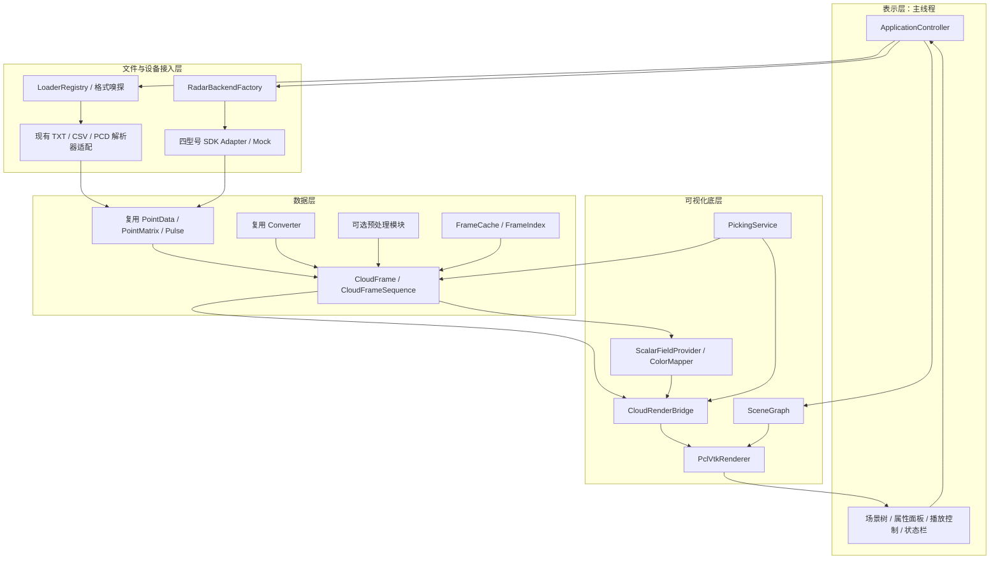
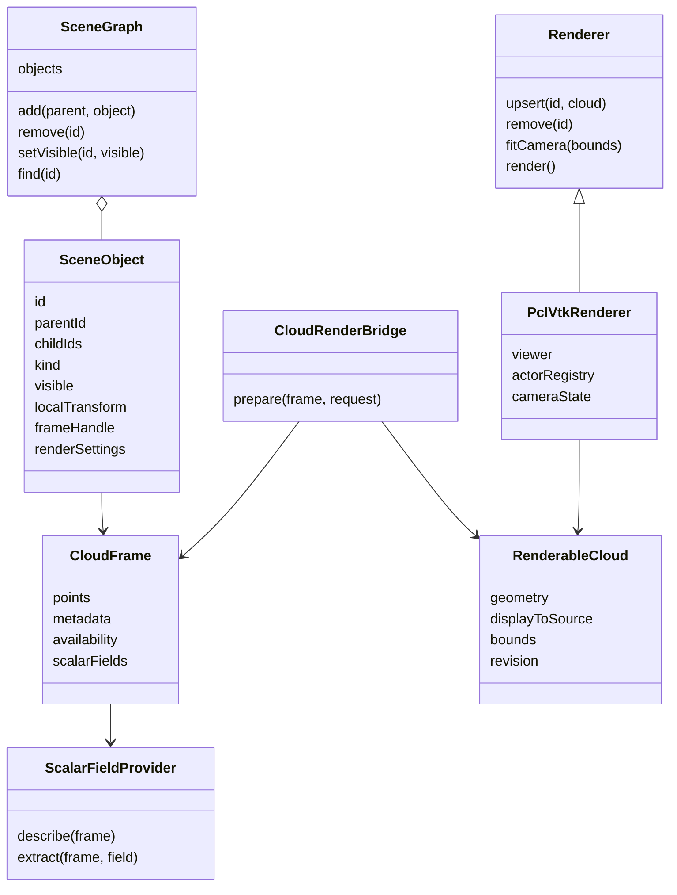

# 激光雷达点云可视化 PC 软件 Lite 版
## `pcl_viewer / cloud_viewer` 系统设计与实施说明

**交付对象：WorkBuddy 编码代理**  
**目标分支：`cloud_viewer`**  
**技术基线：C++17、CMake 3.15+、PCL、VTK**  
**目标平台：Ubuntu 20.04+、Windows 10+，首版均为 x64**

> 本文依据已读取的 `/media/baiusc/DATA11/Repositories/ReposLidar/pcl_viewer/doc/codex_workbuddy_prompts.md` 中“仓库现状速览”设计，不重新探索仓库。本文仅给出方案、接口契约与验收要求，本轮未创建分支、未修改文件。
>
> 下文 `ROOT` 指上述 `pcl_viewer` 仓库根目录；所有新增目录均为**实施阶段规划**。

---

## 设计决策摘要

| 项目 | 确定方案 |
|---|---|
| 产品范围 | 离线加载、在线数据源、点云显示、属性着色、选点、帧播放 |
| 统一数据 | 直接复用 `algo_lidar::PointData`、`PointMatrix`、`Pulse`、`Converter` |
| 显示数据 | `pcl::PointXYZRGB` + 与显示点一一对应的原始点索引 |
| UI | 单个 PCL/VTK 窗口，VTK 控件及二维面板；首版不引入 Qt、ImGui |
| 文件对话框 | Native File Dialog Extended，统一封装 |
| 并发 | 主线程独占渲染；后台解析；SDK 回调与数据转换解耦 |
| 在线缓冲 | 有界队列，最多三个待显示帧；实时模式优先最新完整帧 |
| 多帧 | 索引、按需解码、LRU 缓存；默认只显示当前帧 |
| 标定 | 可选模块；原始数据需要标定时显式要求模块和匹配标定文件 |
| SDK | 四个型号独立工厂注册项；真实 SDK 与 mock 明确区分 |
| 清理 | 先保护基线与依赖，再移出实验代码；不误删解析和必要标定依赖 |
| CloudCompare | 参考实体树、标量场和数据/渲染分离；不链接、不复制其实现 |

---

## 目录

1. 系统总体架构与模块划分
2. 跨平台技术选型与依赖管理
3. 点云结构体与数据流复用
4. 可视化通用底层
5. 离线读取解析与可视化
6. 在线 SDK 接入
7. 属性着色
8. 选点信息交互
9. 雷达适配与标定边界
10. 代码清理范围
11. 开发里程碑与验收

---

# 1. 系统总体架构与模块划分

## 1.1 分层架构



**依赖方向：**

- `core` 不依赖 PCL、VTK、SDK、UI。
- 解析器依赖 `core`；PCD 适配器额外依赖 PCL IO。
- 渲染桥、选点服务依赖 `core + PCL`。
- 渲染器、面板依赖 VTK。
- SDK 仅在对应后端模块内部可见。
- 预处理模块依赖 `core`；`core` 不包含标定算法头文件。
- UI 不调用原始 SDK，不直接解析文件，不直接修改 `PointData`。

## 1.2 模块、职责、关键接口

以下均为设计签名，不是实现代码。

| 模块 | 职责 | 关键接口 | 来源 |
|---|---|---|---|
| `core` | 原始点与帧模型 | `CloudFrame`、`CloudFrameSequence` | 复用结构体，新建帧封装 |
| `io` | 嗅探、索引、解码 | `probe()`、`buildIndex()`、`decode()` | 包装现有读取函数 |
| `preprocess` | 可选标定、坐标修正 | `IFramePreprocessor::process()` | 下沉现有标定 |
| `scene` | 实体树与显示状态 | `add()`、`remove()`、`setVisible()` | 新建 |
| `render` | 点云转换、Actor 生命周期 | `prepare()`、`upsert()`、`remove()` | 复用转换、PclHelperB |
| `color` | 属性提取与颜色映射 | `describe()`、`extract()`、`map()` | 提取现有着色逻辑 |
| `selection` | 加速拾取和原始点回溯 | `buildIndex()`、`pick()`、`resolve()` | 演进 CallbackArgs |
| `stream` | 设备与帧流生命周期 | `open()`、`start()`、`stop()`、`close()` | 新建接口与适配器 |
| `app` | 数据源切换、任务调度、UI | `openFiles()`、`selectFrame()`、`connect()` | 新建 |
| `platform` | 路径、对话框、动态库 | `openFiles()`、`chooseDirectory()` | 新建薄封装 |

补充接口：

```text
ApplicationController
  openFiles(vector<filesystem::path>, LoadOptions) -> TaskId
  openDirectory(filesystem::path, ScanOptions) -> TaskId
  selectFrame(SequenceId, FrameId) -> void
  setColor(SceneObjectId, ColorSettings) -> void
  switchSource(SourceRequest) -> Result<void>
  cancel(TaskId) -> void
  shutdown() -> void

IDataSource
  start(FrameSink, ErrorSink) -> Result<void>
  stop() -> void
  state() const -> SourceState
```

约定：

- `Result<T>` 为项目内统一结果封装，包含错误码、消息及上下文；不依赖 C++23。
- 所有异步结果携带 `TaskId / SourceGeneration / Revision`。
- 数据源切换、帧切换、着色切换后，旧任务的迟到结果必须被丢弃。

## 1.3 实施目录

```text
ROOT/
├── include/
│   ├── point_type.h                 # 保留原有结构体与 Converter 兼容入口
│   ├── cloud_viewer/
│   │   ├── core/
│   │   ├── io/
│   │   ├── scene/
│   │   ├── render/
│   │   ├── color/
│   │   ├── selection/
│   │   ├── stream/
│   │   ├── platform/
│   │   └── app/
├── src/
│   ├── cloud_viewer_main.cpp
│   └── cloud_viewer/                # 与公共头文件目录对应
├── modules/
│   ├── calibration/
│   └── sdk/
├── legacy/                         # 旧调试程序和兼容包装，不默认构建
├── tests/
│   ├── fixtures/
│   ├── unit/
│   └── integration/
├── resources/                      # 字体、色板和默认设置
├── doc/                            # 设计、构建、格式、SDK 接入说明
└── cmake/
```

不采用整个 `src/` 的递归 GLOB；各 target 显式列出源文件，避免实验代码重新进入 Lite 构建。

---

# 2. 跨平台技术选型与依赖管理策略

## 2.1 编译与依赖基线

| 依赖 | 最低基线 | 用途 |
|---|---:|---|
| C++ | C++17 | 全部业务代码 |
| CMake | 3.15 | 主工程最低要求 |
| PCL | 1.10 | IO、点类型、KDTree、可视化 |
| VTK | 7.1 | 兼容 Ubuntu 20.04 系统依赖 |
| Eigen | 3.3 | 沿用 PCL 兼容版本 |
| Native File Dialog Extended | 固定 `v1.2.1` | 原生多文件与目录选择 |
| GTK | 3.x，仅 Linux 对话框 | 不作为主窗口框架 |

最低版本不代表任意 PCL/VTK 组合都兼容。**PCL 与 VTK 必须来自同一个依赖环境，不混用 `/usr`、`/usr/local`、多个 vcpkg 安装。**

### Ubuntu

基础包：

```text
build-essential
cmake
ninja-build
pkg-config
libpcl-dev
libeigen3-dev
libgtk-3-dev
```

VTK 开发包按系统选择：

- Ubuntu 20.04：`libvtk7-dev`，VTK 7.1.1 系列。
- Ubuntu 22.04/24.04：优先使用随 `libpcl-dev` 配套的 `libvtk9-dev`。
- 不为了得到新 VTK，替换已安装 PCL 所链接的 VTK。

Ubuntu 的 VTK 7.1.1 开发包可从官方包归档核对。[Ubuntu 官方包归档](https://security.ubuntu.com/ubuntu/pool/universe/v/vtk7/)

### Windows

确定采用 **Visual Studio 2022、MSVC、x64、vcpkg manifest 模式**：

- PCL 显式启用 `visualization` feature。
- 不启用 Qt feature。
- PCL、VTK、Eigen、Boost、FLANN 等统一由 vcpkg 解析。
- 固定 `builtin-baseline`；实施 M0 将经 CI 验证的提交写入 manifest。
- 使用 `x64-windows` 动态运行库方案；Debug/Release 依赖分别匹配。
- 不同时引入 Conan 和官方 PCL 安装包。

PCL 官方文档提供 vcpkg 接入路径，vcpkg 的 PCL 包将 `visualization` 作为可选特性。[PCL Windows 教程](https://pcl.readthedocs.io/projects/tutorials/en/latest/pcl_vcpkg_windows.html)、[vcpkg PCL 包](https://vcpkg.io/en/package/pcl.html)

## 2.2 CMake 接口约定

主工程声明 C、CXX 两种语言，规避部分 VTK/MPI 依赖的 C target 检查问题。

查找契约：

```text
find_package(PCL 1.10 REQUIRED COMPONENTS common io kdtree search visualization)
find_package(VTK REQUIRED)
find_package(Threads REQUIRED)
```

具体规则：

1. 以 PCL 找到的 VTK 为准；禁止再次找到另一套 VTK。
2. 新版 VTK 使用 `VTK::RenderingCore` 等 imported targets。
3. 旧版 VTK 使用其导出的库变量和必要的 legacy 配置。
4. 当 `vtk_module_autoinit` 存在时，对实际渲染 target 调用。
5. 兼容逻辑集中在 `ROOT/cmake/ViewerDependencies.cmake`。
6. PCL 的 include、definitions、link 依赖封装到项目 `INTERFACE` target，避免全局污染。
7. 新增公开 API 使用 `pcl::shared_ptr`；PCL 1.10/较新版本的底层指针差异不泄漏到调用方。
8. 禁止全局 `-march=native`、`-mavx2`；可移植包不假设目标 CPU 支持开发机全部指令。

PCL 的标准接入入口是 `PCLConfig.cmake`；VTK 新版文档说明了 imported targets 与模块初始化机制。[PCL CMake 文档](https://pointclouds.org/documentation/tutorials/using_pcl_pcl_config.html)、[VTK CMake 文档](https://docs.vtk.org/en/latest/getting_started/using_cpp.html)

## 2.3 UI 决策：首版不引入 ImGui

**采用现有 PCLVisualizer + VTK 交互，不增加 GLFW/SDL/OpenGL 窗口。**

理由：

- 最大化复用已有窗口、相机、Actor、拾取代码。
- 避免 ImGui 与 VTK 的 OpenGL 状态、事件循环、DPI 和输入焦点桥接。
- Lite 版使用单窗口、固定面板，暂不需要复杂停靠与表格编辑。

固定布局：

| 区域 | 内容 |
|---|---|
| 顶部工具栏 | 打开、多文件、目录、设备、暂停、视角复位 |
| 左侧 240 px | 文件/序列/帧实体树，显示与删除开关 |
| 中央 | 唯一三维渲染视口 |
| 右侧 320 px | 着色设置、点信息、设备信息 |
| 底部 80 px | 时间轴、上一帧/下一帧、进度、错误统计 |

实施方式：

- 二维文本与面板采用 VTK text/2D actors。
- 按钮使用二维可点击区域；滑块使用 VTK slider widgets。
- `UiOverlay` 根据屏幕矩形命中分发事件；命中 UI 后不再传给三维相机。
- 数值输入实现独立的 `NumericEdit` 状态：支持数字、负号、小数、退格、Enter、Esc。
- 中文文本统一加载随包字体；字体文件及许可证一起交付。
- 实体树采用缩进、展开/折叠、滚动，不实现复杂拖拽重排。
- 首版不提供脚本终端、算法面板、插件市场。

## 2.4 文件选择、UTF-8 与平台封装

`IFileDialogService`：

```text
openFiles(FileFilter) -> Result<vector<filesystem::path>>
chooseDirectory() -> Result<optional<filesystem::path>>
```

Native File Dialog Extended 提供多平台原生对话框与 UTF-8 API；Linux GTK 后端需要 `libgtk-3-dev`。[项目文档](https://github.com/btzy/nativefiledialog-extended)

路径规则：

- 边界输入输出字符串使用 UTF-8。
- 内部文件路径使用 `std::filesystem::path`。
- Windows 的 UTF-8 与 UTF-16 转换集中到 `platform`。
- 文本读取通过 `filesystem::path` 打开流。
- PCD 读取优先使用能够保留 Unicode 路径的流入口；若对应 PCL API 仅接受窄字符串，`PcdInputAdapter` 负责转换为内存/流读取，不把中文路径直接转成本地代码页。
- `_WIN32` 只出现在平台层和 SDK 适配器。
- 源码 MSVC 启用 `/utf-8`。
- 本地工作路径不写入源码。
- 所有对话框在主线程调用。

## 2.5 兼容矩阵与 CI

| 测试环境 | 依赖来源 | 必测内容 |
|---|---|---|
| Ubuntu 20.04 / GCC 9 | apt / PCL 1.10 / VTK 7.1 | 最低基线、CMake 3.15 |
| Ubuntu 22.04 或 24.04 | 系统 apt 配套 | 常规开发基线 |
| Windows 10 x64 / MSVC 2022 | 固定 vcpkg baseline | 编译、Unicode 路径、打包运行 |

CI 分三层：

1. 无窗口单元测试：解析、帧索引、颜色、映射、队列。
2. Linux Xvfb/Mesa 渲染冒烟测试。
3. Windows/Linux 实机图形验收：拾取、中文路径、设备连接、安装包启动。

Ubuntu 20.04 可通过容器或自托管 runner 保留；不要假设 CI 平台始终提供该系统的托管镜像。

---

# 3. 点云结构体与数据流的复用设计

## 3.1 唯一业务点类型

以下类型保持字段及已有语义：

- `algo_lidar::PointData`
- `algo_lidar::PointMatrix`
- `algo_lidar::PolarPoint`
- `algo_lidar::CartesianPoint`
- `algo_lidar::Pulse`
- `algo_lidar::Converter`

**不增加替代 `PointData` 的自定义业务点结构体。**

新增帧与来源索引属于容器、元数据，不是另一套点数据。

需要从 `point_type.h` 下沉标定函数时：

- 保留结构体兼容入口。
- `Converter` 的纯坐标转换继续属于核心。
- 依赖标定表或设备参数的逻辑移入可选模块。
- 不以“清理”为由重写现有坐标公式。

## 3.2 帧容器

```text
CloudFrame
  id: FrameId
  revision: uint64
  points: algo_lidar::PointMatrix
  metadata: FrameMetadata
  availability: FieldAvailability
  scalarFields: ScalarFieldStore

FrameMetadata
  sourceId / sourceGeneration
  model: RadarModel
  frameNumber
  roiId: optional
  algorithmId: optional
  timestampOrigin / timestampUnit / clockDomain
  sourcePath: optional<filesystem::path>
  sourceFrameOrdinal
  rows / cols
  coordinateFrame / coordinateUnit
  calibrationState / calibrationFingerprint
  totalSamples / validSamples / invalidSamples
```

设计要求：

- 发布后的帧通过 `shared_ptr<const CloudFrame>` 传递。
- 解析和预处理在发布前完成。
- 变更算法或标定时生成新 revision，不修改已显示帧。
- `FieldAvailability` 区分“没有字段”与“值为零”。
- 精确时间戳及其他原始格式信息必要时存于 sidecar，避免现有字段精度不足造成损失。
- 标量 sidecar 与矩阵点槽位对应，缺失值有独立有效位，不使用零代替。
- 非结构化 PCD 用 `1 × N` 矩阵保存；原始 pixel/slot 不存在时显示缺失，不把存储列号伪装为设备列号。
- 同一硬件帧的不同 ROI 首版作为独立子帧显示，不擅自拼接为完整帧。

## 3.3 多帧容器

```text
CloudFrameSequence
  id: SequenceId
  entries: vector<FrameDescriptor>
  current: FrameId
  playbackRate: double
  loop: bool

  frameCount() const -> size_t
  descriptor(FrameId) const -> FrameDescriptor
  requestFrame(FrameId, CancellationToken) -> TaskId
  seek(size_t) -> Result<FrameId>
```

`FrameDescriptor` 保存来源文件、帧号、ROI、算法、字节位置或可重放定位信息，不永久持有整个 `PointMatrix`。

默认行为：

- 多文件构成一个加载集合。
- 集合下分文件节点；文件下分帧节点。
- 默认播放当前文件序列，可切换为集合连续播放。
- 多帧叠加须手动开启，默认上限四帧。
- 叠加表示“共同显示”，不表示已完成时空配准。

## 3.4 PointMatrix → PCL 边界

现有 `mat2pcl / mat2xyzi` 演进为一个无全局状态的 `CloudRenderBridge`：

```text
CloudRenderBridge
  prepare(FrameHandle, RenderRequest, CancellationToken)
    -> Result<RenderableCloud>

RenderableCloud
  geometry: pcl::PointCloud<pcl::PointXYZRGB>::ConstPtr
  displayToSource: vector<SourcePointRef>
  scalarValues
  frameRevision / renderRevision
  bounds
```

`SourcePointRef`：

```text
frameId
matrixRow
matrixCol
selectedEcho
```

**PCL 云只是显示缓存，PointMatrix 才是业务真值。**

### 属性映射表

| 原始字段 | 显示映射 | 点信息读取 |
|---|---|---|
| `x/y/z` | PCL `x/y/z` | 原始 PointData |
| `r` | 标量 → RGB | PointData |
| `intensity` | 标量 → RGB；兼容导出时对应 XYZI intensity | PointData |
| `reflect/peak` | 独立标量 → RGB | PointData |
| `theta/slot_ang` | 独立标量 → RGB | PointData |
| `timestamp` | 相对时间标量 → RGB | 原始精度字段/sidecar |
| `select_idx` | 分类标量 → RGB | PointData |
| `is_tail_pt/is_valid` | 分类标量 → RGB | PointData |
| `cluster_id` | 可选 sidecar → RGB | sidecar，缺失显示 `—` |
| `list_pulse` | 不塞入 PCL 标准字段 | 原始 Pulse 列表 |

不再使用全局 `m_intensity_src_name`，也不把所有属性先缩放到 0～255 再参与业务计算。

## 3.5 完整数据流

```text
文件 / SDK
    ↓
格式解析或 SDK 字段适配
    ↓
PointData / PointMatrix + 字段可用性
    ↓
必要的可选标定与坐标转换
    ↓
不可变 CloudFrame
    ↓
SceneGraph / 帧缓存
    ↓
属性提取 + LOD + 原始点映射
    ↓
RenderableCloud
    ↓
PCL / VTK Actor
```

---

# 4. 可视化通用底层设计

## 4.1 CloudCompare 思想映射

| 参考思想 | Lite 对应对象 | 实现边界 |
|---|---|---|
| `ccHObject` 层次实体 | `SceneObject / SceneGraph` | 自有轻量实体树 |
| 标量场 | `ScalarFieldProvider / ScalarFieldStore` | 复用 PointData 字段、必要时缓存 |
| 显示状态与数据分离 | `CloudFrame / RenderableCloud` | 原始数据不存 VTK 指针 |
| 统一拾取 | `PickingService` | 显示点回溯原始帧 |

CloudCompare 的实体层次与标量场适合作为架构参考；本项目不引入其运行库及 Qt 依赖。[实体类文档](https://mail.cloudcompare.org/doc/qCC_db/html/classcc_h_object.html)、[标量场文档](https://cloudcompare.org/doc/qCC_db/html/classcc_scalar_field.html)

## 4.2 核心类图



## 4.3 接口契约

```text
SceneGraph
  add(SceneObjectId parent, SceneObject) -> Result<SceneObjectId>
  remove(SceneObjectId) -> void
  setVisible(SceneObjectId, bool) -> void
  visibleClouds() const -> vector<SceneObjectId>

IRenderer
  initialize(RenderWindowOptions) -> Result<void>
  upsert(SceneObjectId, RenderableCloudHandle, RenderSettings) -> void
  remove(SceneObjectId) -> void
  fitCamera(optional<Bounds>) -> void
  setBackground(Color) -> void
  render() -> void
```

规则：

- Actor ID 使用稳定实体 ID，不使用文件名作为唯一 ID。
- 子对象最终可见性为“自身可见且所有父节点可见”。
- 删除父节点递归删除 Actor、索引与缓存引用。
- 修改颜色只更新 RGB 数组；不重解析文件、不重建几何索引。
- 只有几何、可见点集合、LOD 或变换变化时，才重建相应索引。

## 4.4 相机和显示交互

| 操作 | 默认行为 |
|---|---|
| 左键拖动 | 旋转 |
| 中键拖动 | 平移 |
| 滚轮 | 缩放 |
| Shift + 左键 | 选点，避免与旋转冲突 |
| `R` | 当前可见点云包围盒复位 |
| `1/2/3` | 顶视/前视/侧视 |
| `A/G/B` | 坐标轴/网格/包围盒 |
| `+/-` | 点大小，范围 1～10 px |
| Space | 离线播放暂停，或在线显示冻结 |
| ← / → | 上一帧/下一帧 |
| Esc | 取消选择或关闭当前面板 |

默认背景深灰，点大小 2 px。空场景相机使用固定初始姿态；零点帧不计算无效质心。

---

# 5. 离线点云读取解析与可视化实现规划

## 5.1 加载接口

```text
IPointCloudLoader
  id() const -> LoaderId
  probe(FileProbe) const -> ProbeResult
  buildIndex(path, LoadOptions, ProgressSink, CancellationToken)
    -> Result<FileFrameIndex>
  decode(FrameDescriptor, LoadOptions, CancellationToken)
    -> Result<FrameHandle>
```

实现类：

| Loader | 复用点 |
|---|---|
| `RotatingTxtLoader` | `readPulseData` |
| `SolidTxtLoader` | `readSolidLidarData` |
| `FrameCsv6532Loader` | `isFrameCsv6532 / readFrameCsv` |
| `FrameCsv6031Loader` | `isFrameCsv6031 / readFrameCsv_6031` |
| `PcdLoader` | `readPcdData / buildMatFromPcd / buildMatFromPcdI` |

`readLidarData` 保留为兼容入口，内部转发至 registry；不得形成两套格式识别规则。

## 5.2 自动路由

按以下顺序执行：

1. 后缀转小写，只作为候选提示。
2. 读取前 64 KiB：去 BOM、规范 CRLF、跳过空行。
3. PCD 检查其标识及字段声明。
4. CSV 按列名集合识别，而不是依赖固定列顺序：
   - 6031：算法、bin/timing/echo 等特征字段。
   - 6532：frame、ROI、row、col、距离或 raw peak 字段。
5. TXT 检测：
   - 固态 `cols/rows` 头及 `start of col`。
   - 转镜 `start of [slot]` 及 angle。
6. 多个匹配时显示“格式/型号选择”面板；用户选择写入当前加载选项。
7. 未识别 CSV 不按任意三列 XYZ 猜测，返回带表头的诊断。

TXT 内容可区分转镜/固态，但 alpha/beta 格式一致时，型号从用户选择或会话配置取得，不从点数猜测。

## 5.3 多帧规则

### CSV

- 基础分组键：`source + frame + ROI + algorithm`。
- `algorithm` 代表同帧处理分支，不当作时间递增帧。
- 对 FL6031：
  - 单算法行布局沿用现有读取函数。
  - 多算法宽表将 v0/v1/v2/v3 解为同帧可选算法分支。
  - 默认优先 v3；不存在时取文件声明的算法，否则取首个明确算法。
- 非连续帧号允许。
- 允许帧行交错；索引保存多个行区间，不假设帧一定连续。
- 同一帧重复 row/col：默认后值覆盖，记录重复计数；严格模式直接报错。

### TXT

- 使用明确的帧标记拆帧。
- 无显式帧标记时，沿用现有 slot/col 周期重启规则建立帧。
- 只有足够明确的重启证据才拆分；歧义输入要求指定分帧规则。
- 文件结束的不完整帧保留，元数据标记 `partial`。

### PCD

一个 PCD 文件视为一帧；多个 PCD 构成序列。兼容 ASCII、binary 和 PCL 支持的 compressed 布局。

## 5.4 多文件交互

- 支持文件多选、目录扫描；目录默认不递归。
- 文件采用自然排序：`Frame2` 在 `Frame10` 之前。
- 跨文件默认按文件顺序；只有时间单位和时钟域明确一致时，才允许按时间合并排序。
- 加载失败的文件保留错误节点，不中断其余文件。
- 提供取消、已扫描文件数、读取字节数、已发现帧数、坏行数、无效点数。
- 用户取消时不发布正在构造的半帧。

错误须包含：文件、行号/字节位置、字段名、错误码。禁止静默跳过整帧。

## 5.5 内存与超大点云

默认参数：

| 项目 | 默认值 |
|---|---:|
| 总数据缓存预算 | 512 MiB |
| 同时解析文件数 | 1 |
| 帧预取 | 前后各 1 帧 |
| 静止显示预算 | 全场景 100 万点 |
| 相机拖动预算 | 全场景 20 万点 |
| 同时叠加帧数 | 4 |
| 在线待显示队列 | 3 帧 |

策略：

1. 先建立帧索引，后按需解码。
2. 帧、显示云、颜色缓存、KDTree 均计入预算；不只统计 XYZ。
3. 点按确定性原始索引抽样，不使用体素质心作为显示点，保证回溯唯一。
4. 预算在可见实体间按点数比例分配。
5. 相机静止 150 ms 后恢复静止级别 LOD。
6. 一帧完整内存超预算时：
   - 可流式解析的格式进入受限导入，保留代表性原始 PointData 及来源定位。
   - UI 明示“抽样加载”和原始/加载点数。
   - 需要完整解码的 PCD 在分配前执行上限检查，提示调整预算。
7. 不把磁盘多帧全部加载进 `vector<CloudFrame>`。

受限导入仍使用 `PointMatrix`，但标记为稀疏/非组织化，不伪造原有矩阵拓扑。

---

# 6. 在线点云可视化接入方案

## 6.1 统一接口与状态机

```text
IRadarStream
  capabilities() const -> RadarCapabilities
  open(DeviceConfig) -> Result<void>
  start(FrameSink, ErrorSink) -> Result<void>
  stop() -> Result<void>
  close() -> void
  stats() const -> StreamStats

RadarDevice
  id / model / backendId
  state
  connect(DeviceConfig) -> Result<void>
  start() -> Result<void>
  stop() -> Result<void>
  disconnect() -> void

RadarBackendFactory
  registerBackend(BackendDescriptor, Creator) -> Result<void>
  availableBackends() const -> vector<BackendDescriptor>
  create(BackendId) -> Result<unique_ptr<IRadarStream>>
```

状态：

```text
Closed → Opened → Streaming → Stopping → Opened → Closed
                      ↓
                    Fault
```

`stop()` 必须等待采集和转换任务退出；`close()` 后不得再触发帧回调。

## 6.2 型号与 SDK 注册

提供资料未给出厂商 SDK 的实际名称、版本及函数签名。设计固定以下后端 ID 和目标类，**不杜撰厂商接口**：

| 雷达 | backend ID | 适配器 | 厂商依赖入口 |
|---|---|---|---|
| alpha 转镜 | `alpha_sdk` | `AlphaSdkAdapter` | 对应 alpha 官方 SDK |
| beta 转镜 | `beta_sdk` | `BetaSdkAdapter` | 对应 beta 官方 SDK |
| FL6031 | `fl6031_sdk` | `Fl6031SdkAdapter` | FL6031 官方 SDK |
| FL6532 | `fl6532_sdk` | `Fl6532SdkAdapter` | FL6532 官方 SDK |
| 回放联调 | `mock_replay` | `MockReplayStream` | 已有离线解析器 |
| 合成联调 | `mock_synthetic` | `MockSyntheticStream` | 现有 PointData/Converter |

构建配置固定：

```text
CLOUD_VIEWER_WITH_ALPHA_SDK=OFF
CLOUD_VIEWER_WITH_BETA_SDK=OFF
CLOUD_VIEWER_WITH_FL6031_SDK=OFF
CLOUD_VIEWER_WITH_FL6532_SDK=OFF
```

每个后端配置 `*_SDK_ROOT`。未启用时工厂返回 `BackendUnavailable`，设备面板显示“未安装 SDK”，不会自动替换成 mock。

如 alpha/beta SDK API 相同，可共用内部实现；对外仍保留两个型号配置。

## 6.3 线程模型

```text
SDK 回调
   ↓ 复制或接管 SDK buffer
有界原始数据队列
   ↓
适配/组帧线程
   ↓ PointMatrix + 可选预处理
不可变 CloudFrame
   ↓ 容量 3 的待显示帧队列
主线程定时消费最新帧
   ↓
统一 SceneGraph / Renderer
```

规则：

- SDK 缓冲若只在回调期有效，返回前完成必要拷贝。
- SDK 回调不得调用 VTK，也不得执行重型标定和着色。
- 丢帧发生在完整帧边界，不从一帧中任意丢数据包制造假完整帧。
- 队列满时丢最旧待显示帧，统计 `droppedFrames`。
- 主线程消费最新完整帧，避免实时显示累积延迟。
- 冻结显示时保留当前帧供选点，采集可继续但不无限堆积。
- 30 Hz 目标显示刷新；数据较慢时不重复重建 Actor。
- 新帧与拾取结果携带 source generation，切源后旧结果失效。

SDK 组帧还须记录：帧超时、缺包、重复包、乱序、帧号回绕。具体协议规则由相应 SDK 契约决定。

## 6.4 Mock 验收边界

Mock 提供：

- 10/20/30 Hz 固定帧率。
- 固定随机种子。
- 可配置乱序帧、断流、坏帧、速度突增。
- 从真实离线帧循环推流。

**Mock 验收证明接入管线、并发和 UI 可用，不等价于真实设备 SDK 验收。**

在线和离线最终都输出 `FrameHandle`，共用渲染、颜色和选点代码。

---

# 7. 点云按属性着色的设计

## 7.1 着色源

```text
ColorSource:
  Range, X, Y, Z, Intensity, Reflectivity, Peak,
  Timestamp, Theta, SlotAngle, EchoIndex, ClusterId,
  IsTailPoint, IsValid, SolidColor
```

界面名称分别对应：

`r/x/y/z/intensity/reflect/peak/timestamp/theta/slot_ang/回波序号/簇 id/is_tail_pt/is_valid/固定色`。

字段契约：

- `theta`、`slot_ang` 显示单位为度。
- `r/x/y/z` 显示单位为米。
- `reflect` 保留原值，不自动假定任意数据都已经标定到 0～1。
- `is_tail_pt`、`cluster_id` 缺失时不可用，不启动检测或聚类算法补值。
- `EchoIndex` 默认展示 `select_idx` 的**峰值排名**，不是光程上的最先/最后回波。
- 原始物理回波序号若存在，作为独立来源字段保存，避免与 peak 排名混淆。

## 7.2 接口

```text
ScalarFieldProvider
  describe(const CloudFrame&) -> vector<FieldDescriptor>
  extract(const CloudFrame&, ColorSource, PointSelection)
    -> Result<ScalarView>

ColorMapper
  map(ScalarView, ColorSettings) -> ColorArray
  legend(ColorSettings, ScalarStats) -> LegendModel

ColorSettings
  source
  mode: Continuous | Categorical | Solid
  rangeMode: Auto | Fixed
  min / max
  palette
  invalidColor
```

直接复用：

- `PclHelperB::hsv2rgb` 的颜色转换逻辑。
- `addCloudI` 中连续映射和离散色板。
- 从 `addCloudI` 提取纯颜色函数，不把 Viewer 操作带入 `ColorMapper`。

## 7.3 归一化规则

连续值：

```text
t = clamp((value - min) / (max - min), 0, 1)
hue = (1 - t) × 2/3
```

即低值蓝、高值红。

边界：

- `min == max` 时使用色带中点。
- `min > max` 拒绝提交设置。
- NaN、Inf、缺失字段显示中性灰。
- 超出自定义区间的值默认截断到端点颜色，不删除点。
- 自动范围仅统计当前选择范围内的有限有效值。
- 在线模式自动范围在首个有效帧建立后冻结，用户点击“重新统计”更新，避免颜色闪烁。
- timestamp 着色先减去帧内时间原点，再转为浮点相对时间；信息面板保留原始精度。

分类值：

- bool 使用固定两色。
- 回波排名使用固定三色。
- cluster ID 经稳定映射到现有离散色板。
- 分类颜色在切帧时保持一致。

## 7.4 Colorbar

- 连续场：`vtkScalarBarActor + vtkLookupTable`。
- 分类场：带文本标签的离散图例。
- 显示字段名、单位、min/max、缺失点数量。
- 多实体不同色标时只显示当前活动实体色标，左侧树显示其他实体采用的字段。
- 不同单位的 timestamp 不共享统一范围。

---

# 8. 选点信息交互设计

## 8.1 保留与演进

复用 `point_selection.h`：

- `CallbackArgs` 的回调上下文组织方式。
- 相机坐标到世界射线的计算。
- 多点云区分思路。

替换：

- 去掉对全部点的 O(n) 逐点射线距离遍历。
- 不通过浮点坐标反查 PointData。
- 不用 PCL actor 的全局点编号直接当作矩阵下标。

## 8.2 正确的 KDTree 射线加速

**对鼠标射线做“距离相机最近的 K 个点”查询并不正确。**

采用 KDTree 候选检索 + 屏幕精确筛选：

1. 根据可见实体包围盒计算射线的有效深度区间。
2. 将像素容差，默认 6 px，转换为各深度处的世界空间拾取半径。
3. 将射线区间划分为若干覆盖段。
4. 对每段使用覆盖该段拾取锥/柱体的包围球执行 KDTree `radiusSearch`。
5. 合并并去重候选点。
6. 将候选投影回当前视口，检查屏幕距离、裁剪范围和正向深度。
7. 优先选择容差内前景深度最小的点，再按屏幕距离排序。

覆盖球必须覆盖整段拾取体；不能用稀疏采样小球导致漏点。

补充：

- 透视与正交相机分别计算半径。
- 实体有变换时，将射线转换到实体局部坐标。
- 本版只支持刚体变换及统一缩放，避免任意非均匀变换使距离判断复杂化。
- 典型查询成本随树查询和候选数增长；极端高密度情况下仍可能退化，不宣称恒定复杂度。
- 若候选数过大，转后台计算，迟到结果按相机/帧 revision 丢弃，不阻塞 UI。

## 8.3 接口与索引

```text
PickingService
  buildIndex(SceneObjectId, RenderableCloudHandle) -> TaskId
  pick(PickRequest) -> TaskId
  resolve(PickHit) -> Result<SelectedPointInfo>
  clear(SceneObjectId) -> void

PickHit
  sceneObjectId
  frameId
  renderRevision
  displayPointIndex
  SourcePointRef
  depth
```

默认拾取当前显示 LOD 中的点；面板明确显示 LOD 状态。

原始映射链：

```text
Actor ID
  → SceneObjectId
  → RenderableCloud
  → displayToSource[index]
  → FrameId + matrixRow + matrixCol
  → 原始 PointData / Pulse
  → FrameMetadata.sourcePath
```

## 8.4 高亮和信息面板

高亮使用独立 Actor，不修改点云原有 RGB。

面板字段：

- 文件路径、数据源、型号、帧号、ROI、算法。
- xyz、r。
- theta、slot_ang、必要时原始 rad 字段。
- intensity、reflect、peak。
- 三组回波 tof/width/peak，以及单位。
- select_idx、原始回波编号。
- pixel_idx、slot_idx。
- 精确时间戳、单位、时钟域。
- is_valid、is_tail_pt、cluster_id。
- 标定状态、标定文件指纹。

缺失值显示 `—`。单位未明确时显示“原始单位”，不把 tof 默认解释为 ns。

切帧清空选择；在线冻结后可持续检查当前选中帧。

---

# 9. 三类雷达适配设计

实际为三类设备形态、四个型号，四个型号分别注册。

## 9.1 差异矩阵

| 型号 | 解析格式 | 坐标计算 | 标定依赖 | 默认着色 | 在线接入 |
|---|---|---|---|---|---|
| alpha 转镜 | 96×800 转镜 TXT；后续 SDK 帧 | 复用 `Converter` 和现有 pixel/slot 角度映射 | 可选距离/角度修正 | intensity，缺失则 r | `AlphaSdkAdapter` |
| beta 薄款转镜 | 与 alpha 同格式 | 共用解析与转换，独立型号配置 | 同上，不默认继承 alpha 标定表 | intensity，缺失则 r | `BetaSdkAdapter` |
| FL6031 | 固态 TXT、单/多算法 Frame CSV | 已有 XYZ 优先；否则用现有 timing/距离转换与设备角度模型 | bin 宽、time zero、算法参数属于解码契约；额外校正可选 | peak，缺失则 r | `Fl6031SdkAdapter` |
| FL6532 | 128×192 ROI Frame CSV、配套 calib_data.bin | 区分已重建数据与 legacy raw 路径 | legacy raw 路径需要匹配标定模块/文件 | reflect，缺失则 peak/r | `Fl6532SdkAdapter` |

## 9.2 坐标策略

```text
IRadarGeometryPolicy
  model() const -> RadarModel
  validate(FrameDraft) -> Result<void>
  populateCoordinates(FrameDraft, GeometryContext) -> Result<void>
```

规则：

1. 已经存在、单位明确的有效 XYZ 不重复重建。
2. 极坐标输入调用现有 `Converter`。
3. 设备坐标的轴顺序、符号、角度含义按现有代码保留，并在格式说明中记录。
4. 不仅依据 `theta` 这个字段名，就假定所有型号使用同一球坐标公式。
5. 设备坐标 → 场景坐标的刚体变换独立保存，默认单位矩阵。
6. 不用某个样本中字段的偶然相关性补充协议含义。
7. 128×192 是 FL6532 的设备/ROI 布局约束，不据此强制每个文件必须包含全部点；稀疏、局部 ROI 和 partial 帧允许。

## 9.3 可选标定模块边界

```text
IFramePreprocessor
  id() const -> PreprocessorId
  configure(PreprocessConfig) -> Result<void>
  requirements() const -> RequiredFields
  process(FrameDraft&, CalibrationContext) -> Result<void>
```

模块：

- `Legacy6532Calibration`
- `DistanceOffsetCalibration`
- `AngleOffsetCalibration`
- `ReflectivityCalibration`

默认 Lite 构建关闭这些模块，但保留接口及状态展示。

### FL6532 的两个模式

**模式 A：已重建/已标定 CSV**

- 使用明确声明的距离、角度或 XYZ。
- 保留已有标定来源。
- 不二次调用 `applyRange6532LegacyCalibration`。

**模式 B：需要 legacy 重建的 raw CSV**

- 复用现有 `applyRange6532LegacyCalibration`。
- 要求对应可选模块启用且 `calib_data.bin` 校验成功。
- 不满足条件时保留文件节点和诊断，不伪造“正确 XYZ”。
- 用户可查看原始数值，但三维显示不可宣称已经完成有效重建。

`calib_data.bin` 至少记录：型号、布局版本、文件大小、哈希、适用数据契约。不能把原始二进制直接按本机结构体强转。

已有历史记录表明，FL6532 legacy 标定模型的复用依赖相同 BIN、表布局和处理契约；此处将其作为保守设计约束，而非确认当前所有设备使用同一模型。

---

# 10. 代码清理范围

## 10.1 总原则

核心仅保留：

> **结构体 + 读取解析 + 坐标转换 + 着色 + 选点 + 渲染 + 数据源调度**

清理顺序修订为：

1. 保护当前工作区及建立回归基线。
2. 创建 `cloud_viewer` 分支。
3. 明确 target 源文件，让实验代码先退出默认构建。
4. 提取解析和可视化复用点。
5. 完成对应回归测试。
6. 再移动或删除旧代码。

**不采用先删文件、后补依赖的方式。**

## 10.2 删除清单

| 项目 | 决定 |
|---|---|
| 新主程序中的硬编码数据绝对路径 | 删除，替换为 CLI/对话框/设置 |
| 旧 main 中长期注释的实验调用 | 在旧入口归档后，从 Lite 入口删除 |
| 重复的 PointXYZ/PointXYZI 可视化函数体 | 合并为普通类成员模板 |
| 全局 `m_intensity_src_name` | 删除，改为实体级 ColorSettings |
| `matlab/` | 确认为空后移除；Git 不保存空目录 |
| 已被新层完整覆盖的兼容包装 | M9 才移除，前提是无调用 |

`doc/` **保留**。当前其中已有 `codex_workbuddy_prompts.md`，不再按旧“空目录”描述删除。

## 10.3 移出默认产品树的清单

| 来源 | 去向 |
|---|---|
| `python/analyze_*.py`，现状说明共 12 个 | 独立算法实验仓库；移出前保存清单与哈希 |
| `python/os_script.py` | 同上 |
| 大量历史标定/分析数据 | 外部数据目录或数据制品存储 |
| 旧调试入口和实验显示流程 | `ROOT/legacy/`，默认不构建 |
| 重复实验头文件，包括带“编译报错”后缀的版本 | 随实验材料归档，不参与构建 |

资料未列出 12 个脚本的逐一名称，因此实施时按指定 glob 生成清单，不编造文件名。

不得通过清空原始数据来“减小项目体积”；先完成副本校验，再移出产品树。

## 10.4 裁剪/下沉清单

| 原代码 | 处理 |
|---|---|
| `Range6532*`、`applyRange6532LegacyCalibration` | 下沉 `modules/calibration/`，保留 raw CSV 所需路径 |
| `applyROffset/applySaOffset/applyRsaOffset` | 下沉可选预处理 |
| `CalibReflect / calc_intensity.h` | 可选反射率模块 |
| `Ground_I / algo_interface.h` | 实验算法模块，不默认构建 |
| `tail_point_filter.h` | 可选算法模块 |
| `fast_euclidean_clustering.h` | 实验算法模块 |
| `Spline.h` | 随实际依赖它的标定模块下沉 |
| `binary_storage.h` | 标定 BIN 需要的部分跟随标定模块，其他归档 |
| `Timer` | 算法依赖解除；应用计时统一 `std::chrono` |
| `buildMatByPulseIdx` | 保留其回波选择所需逻辑，归入数据视图转换 |
| `flipMat/transMat` | 若被解析调用则保留；实验变换下沉 |
| JSON save/load | 默认不纳入 Lite 格式支持，保留为可选兼容模块 |

`PclHelperB` 中以下算法退出默认构建：

- 区域增长、普通/快速欧式聚类。
- 投影、平面/模型拟合。
- 法线估计。
- 最近平面点查找。
- 按簇查找。
- 模型异常值剔除。
- 非可视化必需的索引反查工具。

`getSubCloud` 若被兼容显示函数使用，可暂留轻量兼容层；核心显示不依赖聚类。

## 10.5 保留清单

- `PointData/PointMatrix/PolarPoint/CartesianPoint/Pulse/Converter`。
- 各 TXT、CSV、PCD 读取逻辑及格式嗅探。
- `PclHelperB` 的可视化能力。
- `point_selection.h` 中可复用回调与射线构造。
- `mat2pcl/mat2xyzi` 的坐标和有效点筛选逻辑。
- 必要的小型、可公开回归样本。
- 标定模块所需的二进制布局知识及测试。
- 现有许可证、第三方声明。
- 本次设计资料所在 `doc/`。

---

# 11. 开发里程碑与分阶段任务拆解

共十个里程碑，按顺序交付。下列命令是**计划中的验收接口**，本轮未执行。

统一验收原则：

- 每阶段交付变更文件、构建命令、测试命令、实际输出、失败项。
- 没有真实 SDK/设备的项目不能标成“真实在线接入完成”。
- 每阶段通过后再进入下一阶段。
- 用户已有未提交改动不覆盖，不自动提交。

## M0：分支、基线与构建骨架

**目标：**得到独立、可移植的 Lite 构建入口。

**任务：**

- 检查当前分支和未提交改动，基于确认的工作基线创建 `cloud_viewer`。
- 保存各旧解析函数的样本输出。
- 建立显式 source list 和模块 target。
- 旧实验代码退出默认构建，但先不物理删除。
- 固定依赖和 Windows vcpkg baseline。
- 主程序支持无参数启动空窗口。

**涉及文件：**

`ROOT/CMakeLists.txt`、`ROOT/cmake/ViewerDependencies.cmake`、`ROOT/src/cloud_viewer_main.cpp`、`ROOT/vcpkg.json`。

**验收：**

```text
cmake -S . -B build -DCMAKE_BUILD_TYPE=Debug
cmake --build build
```

Windows 使用 vcpkg toolchain 配置后：

```text
cmake --build build --config Debug
```

两平台均编译成功；空窗口可关闭；默认 target 不链接地面修复、聚类和标定算法。

---

## M1：统一帧模型与显示映射

**目标：**统一内存表示且不丢失来源。

**任务：**

- 实现 CloudFrame、FrameMetadata、序列描述符。
- 建立字段可用性与 sidecar。
- 实现 CloudRenderBridge。
- 移除转换过程中的全局着色状态。

**涉及文件：**

`ROOT/include/cloud_viewer/core/`、`ROOT/src/cloud_viewer/core/`、`ROOT/include/cloud_viewer/render/`。

**验收：**

```text
ctest --test-dir build -C Debug -R "frame|mapping" --output-on-failure
```

至少验证：

- 2×3 矩阵转显示云，点数和映射一致。
- 无效点筛除后原始索引仍正确。
- PointXYZ/PointXYZI 输入兼容。
- 颜色字段切换不改 PointData。
- 缺失 timestamp 与值为零的 timestamp 可区分。

---

## M2：五类离线格式与帧索引

**目标：**单文件、多文件、单帧、多帧按统一入口读取。

**任务：**

- 五个 Loader。
- BOM、CRLF、中英文表头、列顺序变化处理。
- CSV 多帧/ROI/算法索引。
- TXT 分帧。
- Unicode 路径、进度、取消、坏行统计。

**涉及文件：**

`ROOT/include/cloud_viewer/io/`、`ROOT/src/cloud_viewer/io/`、`ROOT/tests/fixtures/`。

**验收：**

```text
cloud_viewer --inspect <sample> --report <report.json>
```

真实样例包括：

- 转镜 TXT。
- 固态 TXT。
- `Frame1_ROI0_distRP.csv`。
- FL6031 单算法/多算法 CSV。
- `0811固态雷达6532.pcd`。

新旧解析结果比较：点数、有效点数、矩阵位置、代表点字段一致；XYZ 差异不大于 `1e-5 m` 或该文本本身的量化误差，取较大者。必要标定输入必须相同。

---

## M3：场景树与基础渲染

**目标：**统一窗口承载所有离线显示。

**任务：**

- SceneGraph、Actor 注册表、Renderer。
- 相机、坐标轴、网格、包围盒。
- 文件树、可见性、删除、当前帧。
- 旧 showCloud* 转为兼容包装，不再自行创建多个独立主循环。

**涉及文件：**

`ROOT/include/cloud_viewer/scene/`、`ROOT/src/cloud_viewer/render/`、`ROOT/src/cloud_viewer/app/`。

**验收：**

```text
cloud_viewer --open <file1> <file2>
```

可分别隐藏/删除对象；Actor 无重名；相机操作正常；空帧不崩溃；连续切换 100 次不累计残留 Actor。

---

## M4：着色和 Colorbar

**目标：**属性驱动显示，不污染原始数据。

**任务：**

- ScalarFieldProvider、ColorMapper。
- 连续、分类、自定义区间。
- 时间戳相对归一化。
- 实体独立着色和色标。

**涉及文件：**

`ROOT/include/cloud_viewer/color/`、`ROOT/src/cloud_viewer/color/`、属性面板。

**验收：**

```text
ctest --test-dir build -C Debug -R color --output-on-failure
```

覆盖最小/最大/常量/NaN/缺失/越界；运行时切换所有可用字段。不存在的字段显示不可用，不生成假数据。

---

## M5：KDTree 选点与完整来源回溯

**目标：**显示点能精确定位原始帧、原始记录。

**任务：**

- 回调上下文改造。
- KDTree 射线候选查询。
- 多实体深度排序。
- 独立高亮 Actor。
- 完整字段面板。

**涉及文件：**

`ROOT/include/point_selection.h`、`ROOT/include/cloud_viewer/selection/`、`ROOT/src/cloud_viewer/selection/`。

**验收：**

- 对固定测试场景点击预设屏幕位置，命中预期 FrameId/row/col。
- LOD 后仍回溯正确。
- 多云重叠优先前景点。
- 相机变化后迟到结果不误选。
- 参考机器上 10 万显示点拾取 p95 ≤ 100 ms；记录 CPU/GPU、点数和候选数。
- 高密度退化查询不阻塞主窗口。

---

## M6：序列播放、缓存与 LOD

**目标：**多帧播放不无限占用内存。

**任务：**

- FrameCache、预算管理、预取、LRU。
- 播放/暂停/步进/倍速/循环。
- 超大帧受限导入。
- 相机运动 LOD。

**涉及文件：**

`ROOT/src/cloud_viewer/core/FrameCache*`、播放控制器、渲染桥。

**验收：**

- 连续播放至少 1,000 帧，缓存计账不超过设定预算。
- 峰值内存测试单独记录依赖库与临时分配开销。
- 取消加载后停止后续帧发布。
- 全场景显示点数符合 LOD 上限。
- 最大簇、抽稀和显示不成为解析副作用。

---

## M7：在线框架、Mock 与四型号注册

**目标：**在线与离线共用同一管线。

**任务：**

- IRadarStream、RadarDevice、工厂。
- 四型号 SDK feature flags。
- 三帧有界队列、统计、冻结和切源。
- MockReplay/MockSynthetic。

**涉及文件：**

`ROOT/include/cloud_viewer/stream/`、`ROOT/src/cloud_viewer/stream/`、`ROOT/modules/sdk/`。

**验收：**

```text
cloud_viewer --source mock_replay --open <sequence> --fps 20
```

持续十分钟；队列不超过三帧；慢渲染时丢旧完整帧；断流可恢复；反复切换在线/离线无后台线程泄漏。

无 SDK 时真实 backend 返回明确状态，不伪装连接成功。

---

## M8：标定模块与真实 SDK 联调

**目标：**完成有真实依赖支撑的设备适配。

**任务：**

- 下沉并验证 FL6532 legacy 标定。
- 已标定数据防二次校正。
- 获取各 SDK 后绑定厂商 API、版本和资源释放规则。
- 四型号真实数据联调。

**涉及文件：**

`ROOT/modules/calibration/`、`ROOT/modules/sdk/`、设备/标定测试。

**验收：**

- 已重建 CSV 在关闭标定模块时能正常显示。
- raw 6532 在缺少匹配 BIN 时给出明确诊断。
- 同一 raw 输入及 BIN，新旧重建结果满足 M2 的数值误差要求。
- 每个已具备 SDK 的型号完成连接、收帧、显示、着色、选点、停止、断线测试。
- 未取得 SDK 的型号单独列为待交付项，不计入真实设备通过数。

---

## M9：清理收口、跨平台打包与交付

**目标：**形成可分发 Lite 软件。

**任务：**

- 执行第 10 章移动/删除清单。
- 删除过渡期兼容层中的死代码。
- 安装资源、字体、许可证。
- Linux 打包 DEB；Windows 打包 ZIP，附带所需 DLL。
- 默认不打包 SDK 和标定模块；需要时单独增加。
- 完成 README、格式说明、设备接入说明和故障排查。

**涉及文件：**

`ROOT/doc/`、`ROOT/README.md`、`ROOT/cmake/`、安装规则、CI 配置。

**验收：**

- Ubuntu 20.04 与 Windows 10 干净环境安装并启动。
- 中文文件路径加载成功。
- 五类格式端到端加载、着色、选点通过。
- 默认 Lite 包不包含实验算法 target 和大体积测试数据。
- 构建、测试、打包命令可从文档复制运行。
- 提交依赖版本、样本清单、测试报告、已知问题以及真实 SDK 覆盖状态。

---

## WorkBuddy 实施交接约束

1. 按 M0～M9 顺序实施，每阶段独立验收。
2. 优先移动、包装、提取现有函数；不得以“架构升级”为由重写等价解析。
3. `PointData/PointMatrix` 始终作为业务数据真值。
4. PCL 云仅作为显示/搜索派生缓存，任何筛选或 LOD 都保留来源映射。
5. 标定模块默认可选，不等于对依赖标定的原始格式静默跳过标定。
6. 不编造 SDK 名称、字段单位、坐标公式、BIN 布局和缺失属性。
7. 实际代码与现状说明冲突时，先保留兼容行为，并在阶段报告列出差异及证据。
8. 最终交付分别标明：**离线功能完成度、Mock 完成度、真实 SDK/设备完成度**。