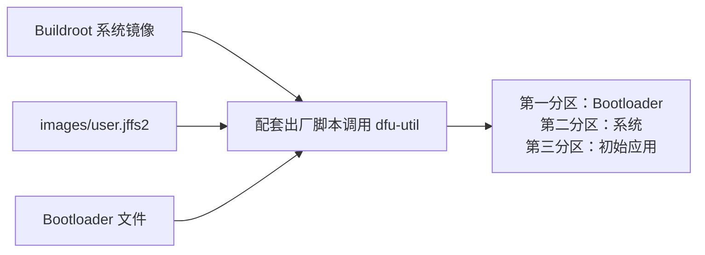

# Beta 镜像测试集成包

本包用于 Beta 新启动链与点云模式 1/2 的镜像测试。完整业务应用、Web 来自第三分区；基础启动、验签、公钥、驱动和诊断页来自系统镜像。源码含开发改动，应用清单 `release=false`，本包使用开发公钥，不作为正式出厂发布。

先看 `kit-report.json`：记录实际文件摘要、所选驱动、标定来源、待补齐项及第三分区镜像参数。确认目标硬件配套再操作，不用于 238。

重新生成交付包时，`scripts/prepare_beta_image_kit.py` 默认采用本仓库 `platform/beta/motor` 的电机源码编译产物，放入 overlay 并记录 SHA256；无需再从雷达复制预编译程序。源码、单独编译与安装方法见 [Beta 电机程序说明](../../platform/beta/motor/README.md)。已生成的历史交付包保持原内容。

## 交付目录

```text
overlay/                      合入 Buildroot 的系统文件
  etc/init.d/                 S35 挂载、S90 Web、S98 管理服务准备
  etc/lidar/                  配置、公钥、模块构建标识
  usr/libexec/lidar/           boot、crypto、SN出厂写入工具、启动/存储/Web/硬件脚本、驱动与电机程序
  usr/share/lidar/             监督模板、独立 Web 诊断页及所需运行时
third-partition/lidar/        第三分区的初始目录，不是根文件系统
  releases/<版本>/            完整应用、统一 liblidar.so、完整 www、签名清单
  current -> releases/<版本>
  config/                     首次启动从签名包导入默认 INI
  calibration/                本机三个标定文件
  state/                      首次启动后产生事务状态
images/user.jffs2             第三分区原始镜像；仅供首次受控初始化
tools/                       离线合入、校验、补齐及制镜像工具
reference/                   原始 Web 归档、三种原始驱动；不自动安装
SHA256SUMS                   交付校验清单
kit-report.json              交付状态及来源
```

`S35lidar_storage` 在启动时以只读方式挂载第三分区，将当前应用版本、Web、配置和本机标定复制到 `/run/lidar-data`，然后卸载。管理、采集和 Web 从 RAM 验签启动。根目录 `/www` 由 post-build 设为 RAM 链接，日志、上传目录和 PID 文件位于 Web 的运行副本。验证失败时使用系统镜像的诊断页。

提供的原始 Web 归档在 `reference` 完整保留；运行版本增加 `lidar_status.cgi/lidar_switch.cgi`，禁用直接擦写 Flash、上传旧包、重启、修改 SSH 和旧目录切换入口，统一返回 501。旧网页中的对应按钮暂不可用，上位机继续使用既有 HTTP 模式管理接口。本阶段没有在线升级 API，也没有通过 Linux 烧写 FPGA 的功能；旧包中存在的 FPGA 写入入口一并禁用。

## 第一步：检查交付物与硬件来源

```bash
cd /实际路径/本交付包
sha256sum -c SHA256SUMS
python3 tools/beta_image_tools.py check .
python3 tools/beta_image_tools.py check . --ready
```

最后一条检查电机程序与三个标定是否已提供，不能把普通完整性校验当作真实采集就绪。若本次包带有 221 标定，仅供 221 镜像测试，不直接用于另一台雷达。系统 rootfs 会包含 `/usr/libexec/lidar/lidar_sn_provision`，但不会自动写 SN；首次启动 Linux 后由产线提供 MES 分配的 SN 并显式写入第四分区。

若缺少硬件输入，先补齐；工具拒绝覆盖已有不同文件，应为另一台设备重新整理交付目录：

```bash
python3 tools/beta_image_tools.py provision . \
  --motor-init /实际路径/demo_i2c_motor \
  --calibration-dir /本机标定目录
```

标定目录需要 `ys_calibration.ini`、`ys_encoder_angle.csv`。补充标定后重新生成第三分区镜像。补齐会更新本目录清单，但不会自动重打外层 tar.gz；传递时以重新打包后的目录为准。

## 第二步：系统同事合入 Buildroot

以下工作在编译主机进行，不在雷达上执行。

将本包保存到 Buildroot 的 `board/ti/lidar-beta-kit`，然后合并系统文件到既有 overlay，保留同事原有 SSH 等配置：

```bash
cd /home/huyidao/workspace/buildroot_ti_am6204
rsync -a board/ti/lidar-beta-kit/overlay/ board/ti/overlay/
```

Buildroot 配置由系统同事维护。确认以下两项；若已有其他 post-build 脚本，保留并按实际顺序追加本脚本：

```text
BR2_ROOTFS_OVERLAY="board/ti/overlay"
BR2_ROOTFS_POST_BUILD_SCRIPT="board/ti/lidar-beta-kit/tools/post-build.sh"
```

为 `tools/post-build.sh` 设置可执行权限。BusyBox 保留 init，开启 `RUNSV/RUNSVDIR/SV`；本包不更换 PID 1。还需提供 `logger`、`syslogd`、`fuser`、`insmod`、`sha256sum`、`cp/readlink/mv/rm`、`mount/umount`、`start-stop-daemon` 等已有系统工具。`mv` 需要支持 `-T`。配置中工具路径见 `overlay/etc/lidar/service.conf`。

网络服务启用时，post-build 会从 `output/build/avahi-*/config.h` 读取目标 Avahi 的 `HAVE_DBUS`，并据此写入系统网络配置的 `avahi_dbus_supported`。必须能唯一找到该文件；若 Buildroot 目录布局不同，手动调用集成脚本时用 `--avahi-config-header` 指定。请在目标板或隔离运行环境验收真实 Avahi 启动，确认 `mdns_running=true` 并持续超过 60 秒。

提供 AArch64 程序需要的 glibc/动态加载器、`libstdc++.so.6`、`libgcc_s.so.1`、`libm.so.6`，以及 `libcrypto.so.1.1` 或 `libcrypto.so.3`，并检查工具链 ABI 兼容。驱动当前 `vermagic` 见 kit-report，需与所烧内核配套；不能只按文件名认定兼容，也不要强制加载。

post-build 自动执行以下步骤：

1. 检查交付包摘要、签名、完整性及必要硬件文件。
2. 合入系统文件，把旧 `S99user` 移到 `/usr/share/lidar/legacy`，拒绝其他旧采集或 Web 双重启动入口。
3. 保留 inittab 的控制台、rcS 和关机项，仅追加一条 runsvdir 的 respawn。
4. 将 `/www` 链接到 `/run/lidar-web/current`；标定 `/etc` 路径链接到第三分区本机标定。
5. 检查监督工具和 libcrypto，失败时阻止生成可交付镜像。

旧 `app_startup.sh` 曾顺便设置网络、SSH、PTP。系统同事必须将这些能力保留为正常系统服务；本包不会从 Flash 再运行 `install.sh`。不再设置开发用固定日期，也不等待固定开发机的 ping。

## 第三步：制作第三分区镜像

包内若已提供 `images/user.jffs2`，可先检查；如果补充了本机标定，应重新制作。主机工具使用 Python 3.9 或更新版本。优先使用同事 Buildroot 构建出的主机工具，不在雷达上执行；可由同事启用 `BR2_PACKAGE_HOST_MTD=y`，构建后提供下面的 `output/host/sbin/mkfs.jffs2`：

```bash
python3 board/ti/lidar-beta-kit/tools/beta_image_tools.py make-jffs2 \
  board/ti/lidar-beta-kit \
  --mkfs output/host/sbin/mkfs.jffs2 \
  --erase-size 0x10000 --partition-size 0xff0000
```

原布局：32 MiB NOR；第三分区偏移 `0x1000000`、长度 `0xff0000`，擦除块 `0x10000`；第四分区 SN 从 `0x1ff0000` 开始。上述参数已从 221 实机与设备树核对。镜像为小端，页大小 4096，只使用当前内核支持的压缩，属主统一为 root，最终以 `0xff` 填充到完整第三分区长度。清单记录填充前使用量。

若同事调整了分区，需同时改设备树、U-Boot 读取/DFU 范围和本工具参数，并重新生成镜像。本阶段沿用原布局。

`flash-seed.tar.gz` 或普通 tar.gz 不能作为 JFFS2 原始镜像写入。也不要直接开启 Buildroot 的“JFFS2 根文件系统”选项来替代这个步骤，否则打包的是 TARGET_DIR，不是第三分区应用目录。

## 第四步：首次烧录



本包不包含 Bootloader 或系统 FIT，也不包含已猜测目标名称的 DFU 烧录命令。系统同事应在现有脚本中明确增加第三分区镜像，核对设备端 `dfu_alt_info` 暴露的目标、介质、偏移和长度。可以让操作员执行一次脚本，内部依次写多个文件；不要求拼成一个覆盖整片 Flash 的 img。

必须确认写入的是持久 Flash，而不是仅下载到 RAM。首次第三分区初始化应确保完整区域先被正确擦除，不能保留旧 JFFS2 节点；第三分区镜像写入范围严格止于 SN 分区。重复烧录不覆盖 SN。系统启动后，先核对设备与 MES 的序列号记录，再执行 `/usr/libexec/lidar/lidar_sn_provision <19位SN>`；工具校验分区标签与擦除范围，拒绝覆盖其他内容并回读确认。随后执行 `/usr/libexec/lidar/lidar-network-service restart`，让 Avahi 使用刚写入的身份重新发布。整片擦除、迁移旧数据或备份由现有受控出厂流程处理，本工具不自动执行。

FPGA 使用已有、与点云配套的逻辑，继续按现有 IDE/JTAG 流程配置。未提供 `.bit`，交付包不包含或假定某个 FPGA 位流。

## 第五步：新镜像首次启动验收

BusyBox init 启动 rcS。S35 只读挂载第三分区，复制到 RAM 后卸载。S90 验证版本并启动 Web，S97/S98 准备监督服务。rcS 返回后，runsvdir 拉起网络服务和管理服务，管理服务再启动采集。

```bash
cat /proc/mtd
mount
cat /run/lidar-web/verify-error
cat /www/启动状态.txt
/usr/libexec/lidar/lidar_boot verify /etc/lidar/boot.json
/usr/libexec/lidar/lidar-service status
pidof lidar_mgrd you_see
```

电脑访问 `http://设备IP/cgi-bin/lidar_status.cgi`。用现有上位机验证 `2 → 1 → 2`、重新握手和真实数据接收。状态确认需要同时检查目标模式、健康状态及错误字段，不能只看 HTTP 202。

随后验证 stop 后不自动拉起，start 后只有一个管理与采集进程。`/proc/mounts` 在正常采集、服务重启及一次保存成功后都应查不到 `/mnt/mtdblock2`。在专用板上硬断电，再核对采集、最后确认的模式与网络配置、本机标定和用户参数。还需验证保存中断及包损坏时能否进入系统诊断。

## 后续应用升级

网页接收签名应用包、版本安装、激活与失败回退尚未实现。现有模式切换 API 保持不变，本包禁用旧升级 CGI，避免绕过管理服务直接擦写分区。首次烧录的 `user.jffs2` 不作为以后日常升级格式，也不在运行中覆盖整个第三分区。
