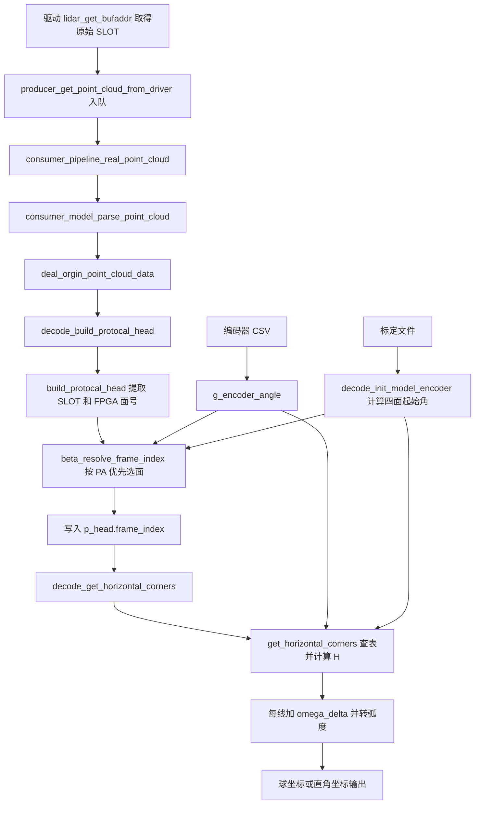

# CS96 Beta：SLOT 原始角度到水平角转换梳理

核对日期：2026-10-26。源码基线：`d8e730f319a366fe0d3000749add861afbe92b71`，按当前工作区实际文件读取；本次仅新增本文档，未修改程序。工作区已有其他未提交修改。本文未读取设备、未核对当前板端二进制与配置，关于协议物理含义的判断以“程序如何解释数据”为准。

## 1. 核心结论与公式

正式点云路径中，非零 SLOT 的水平角为（中间角度均为度）：

```text
v = header[0] | header[1]<<8 | header[2]<<16 | header[3]<<24
slot_number = v & 0xFFF
mirror_angle = (v >> 12) & 0xFFFFF
scale = (mirror_angle >> 12) & 0xFF
real_angle = mirror_angle & 0xFFF
A = g_encoder_angle[scale] + 0.0009 × real_angle
S[i] = (angle_face[i] + side_angular_offset[i] / 256.0) × 360 / 240
D = A - S[最终面号]
如果 D > 180：D -= 360；否则如果 D < -180：D += 360
H = 2 × D + omega0
第 j 线实际使用的水平角（弧度）= (H + omega_delta[j]) × π / 180
```

`mirror_angle` 不是可直接乘固定比例的整个 20 位线性角度。高 8 位是查表索引，低 12 位按固定系数换算为刻度内增量。机械转镜角相对本面起点的差值乘 2，按反射转镜的常见关系理解为光束水平角；物理定义和正方向需要 FPGA 同事对照确认。

`slot_number` 除了区分 SLOT 0，不参与非零 SLOT 的角度计算。Beta 不使用 `slot_number × 0.15`，不使用前一个 SLOT 的角度差，不以 SLOT 1 重新建立基准，也不调用 Alpha 的 `get_spot_slope()` 水平角修正分支。时间戳不参与该角度公式，Beta 包装函数最后传入 0，算法也明确忽略 `relative_time`。

SLOT 0 的实际结果是 `H = 3 × omega0`，并未使用其携带的角度进行最终水平角计算；这是现有程序行为，需单独检查是否符合预期。

## 2. 原始字节与位关系

以下偏移相对于 FPGA 原始 SLOT 的 16 字节 `header`，不是 ARM 外层网络协议包的起点。

| 字节/位 | 程序解释 |
| --- | --- |
| byte[0] | SLOT 号低 8 位 |
| byte[1] 低 4 位 | SLOT 号高 4 位 |
| byte[1] 高 4 位 | mirror_angle 的低 4 位 |
| byte[2] | mirror_angle 的 bit[11:4] |
| byte[3] | mirror_angle 的 bit[19:12]，也就是 scale |
| byte[4..13] | 10 字节时间戳，不参与水平角换算 |
| byte[14] | FPGA frame ID，回退面号为此值 `% 4` |
| byte[15] | 保留 |

因此也可直接复核：`scale = header[3]`，`real_angle = (header[2] << 4) | (header[1] >> 4)`。SLOT 实际解析宽度为 12 位，结构体原注释写的 `slot_num(10 bit)` 与实现不一致。

## 3. 调用与数据关系



`build_protocal_head()` 先设置 `frame_index = header[14] % 4`，但 Beta 的 `decode_build_protocal_head()` 随后覆盖它。因此不能仅看共享包头函数，就认定程序始终采用 FPGA 面号。

原始点云透传分支 `consumer_pipeline_raw_point_cloud()` 调用面有效性判断，再调用 `inverted_orgin_point_cloud_data()` 反转像素顺序，复制原始头，不执行上述水平角转换。其面有效性判断虽然使用 PA 判面，但不会改写原始头里的 FPGA 面号。灰度图和原始直方图也不属于本文正式点云角度转换路径。

## 4. 参数从哪里来

| 参数 | 来源及含义 |
| --- | --- |
| `g_encoder_angle[scale]` | CSV 数据行第 2 列，依次追加到数组，单位按度使用 |
| `angle_face[i]` | 标定文件 `[standard_encoder] angle_face_1..4`，分别映射到数组下标 0..3 |
| `side_angular_offset[i]` | `[side_angular_offset] side0_angular_offset..side3_angular_offset`，按 1/256 个刻度使用 |
| `omega0` | `[parameter] omega0`，默认 -60° |
| `g_omega_delta[j]` | `[horizontal_angular_offset] omega_delta0..`，每线水平角补偿，单位度 |

实机默认路径为 `/etc/ys_encoder_angle.csv` 和 `/etc/ys_calibration.ini`；`LOCAL_TEST=1` 的 Beta 使用 `./conf/ys_encoder_angle.csv` 和 `./conf/ys_calibration.ini`。仓库配置不等于设备当前配置。

加载顺序：`core_load_cal_ini()` 加载角度表与标定；`init_decode_paramter()` 调用 `parse_ini_file()` 拷贝逐线补偿，再调用 `decode_init_model_encoder()` 计算四面的 `g_staring_angle[]`。原变量名就是 `staring`。

仓库 CSV 经复核有 241 条数据，索引 0..240，首尾角度为 0°、360°。例如 `table[1]=1.506212606`，`table[20]=30.0648`，`table[239]=358.4737359`，不是完全等间距表。加载器只检查第 1 列开头是否为数字，不使用第 1 列作为数组下标；因此缺行、乱序或重复行会影响之后索引含义。

## 5. PA 判面如何影响水平角

`beta_get_pa_frame_index()` 使用相同的 `A = table[scale] + 0.0009 × real_angle`，先用循环归一到 `[0,360)`；对每个面计算 `A - S[i]`，再用循环归一到 `[-180,180]`。

判面常量为：每圈 240 刻度、每面扫描范围 40 刻度、前后各容差 5 刻度。因此唯一命中条件为：

```text
-7.5° <= wrap(A - S[i]) <= 67.5°
```

只有恰好一个面命中才采用该面；没有命中、多个面命中、表为空、索引越界或四面参数未就绪，都返回 -1，回退到 `header[14] % 4`。每个 SLOT 单独判定，不锁定整面面号。

面号决定减去哪个起始角；若四面起始角约相差 90°，错面会令乘 2 后的水平角出现约 180° 等量级的偏差，跨界时还受归一分支影响。PA 判面和最终水平角使用同一角度表与起始参数，参数错误可能同时影响两处，PA 纠偏日志不能独立证明 FPGA 面号一定错误。

## 6. 复算例子

以下仅为构造示例，不代表设备实际参数。取 SLOT=123、scale=20、real_angle=1000，前四字节可为 `7B 80 3E 14`。

```text
小端 v = 0x143E807B
mirror_angle = 0x143E8
scale = 0x14 = 20
real_angle = 0x3E8 = 1000
A = table[20] + 0.0009 × 1000 = 30.9648°
假设最终选中面起始角 S = 30°，omega0 = -60°
D = 0.9648°
H = 2 × 0.9648 - 60 = -58.0704°
若该线 omega_delta = 0，则输入坐标换算的水平角为 -58.0704 × π/180
```

跨零例子：`A=5°、S=355°`，差值 -350° 经加 360 得 10°，若 `omega0=-60°`，最终 H=-40°。

## 7. 已确认的行为与待核查点

### 7.1 SLOT 0 重复使用零点偏移

`get_horizontal_corners()` 在 SLOT 0 分支把 `horizontal_corner` 赋为 `omega0`，退出分支后仍执行 `horizontal_corner * 2 + omega0`。当 `omega0=-60°` 时实际为 -180°，而不是 -60°。正式点云函数没有为 SLOT 0 跳过像素处理；仍按普通 SLOT 输出。应核实 SLOT 0 是同步标记、有效测量，还是无效像素，以及期望角度。

### 7.2 最终角度查表缺少防护

PA 判面函数检查了表指针、表长度和 `scale` 上界，但最终水平角函数直接读取 `g_encoder_angle[scale]`。若表缺失、加载失败或 scale 越界，PA 判面只会回退到 FPGA 面号，不能阻止之后的非法访问。仓库表长度 241，收到 scale=241..255 就会越界。`core_load_cal_ini()` 没有处理 `init_encoder_angle_table()` 的失败返回值。

### 7.3 仓库默认面参数与 Beta 的 240 刻度单位存在明显冲突

仓库 `conf/ys_calibration.ini` 的四个起始编码值为 3000、19384、35768、52152，偏移为 0。按当前 Beta 公式，四面起始角分别为 4500°、29076°、53652°、78228°，而非正常一圈内的角度。最终水平角只加减一次 360°，因此不能把这种差值正确归一。

PA 判面用循环归一，故它和最终角度函数在异常起始参数下的表现还可能不同。该结论针对仓库文件；未读取设备 `/etc/ys_calibration.ini`，不能据此断定实机正在使用这些值。应优先核对实机启动日志 `starting_angle` 与实机参数单位，确认是否沿用其他编码器体系的默认配置。

### 7.4 粗刻度查表、起点却按理想刻度计算

当前角 `A` 用非等间距角度表；起始角 `S` 用 `angle_face × 1.5°`，未查同一张表。若 `angle_face` 表示同一编码器的整数刻度，则会引入 `table[angle_face] - 1.5 × angle_face` 的机械角差，最终水平角误差约为其两倍（先不考虑细调）。例如仓库 `table[20]=30.0648°`，理想起点为 30°，相差 0.0648°，对应水平角 0.1296°。是否应查表取决于面起始寄存器的真实定义。

### 7.5 0.0009 系数与低 12 位有效范围

代码固定每个低位单位对应 0.0009°机械角，最终水平角为 0.0018°。12 位完整范围 0..4095 对应 0..3.6855°，大于约 1.5°的单个粗刻度间隔。位宽不等于有效数值一定占满；必须确认 FPGA 低位表示时间、相位细分还是角度，以及其真实有效范围。粗刻度切换处应满足 `table[s] + 0.0009 × 上一刻度末值` 与 `table[s+1] + 0.0009 × 下一刻度初值` 连续。代码没有检查细分值范围或插值跨度。

### 7.6 面号、方向及标定单位

核对 byte[14] 从 0 还是 1 起算、每次跨面是否递增、是否与同一个 SLOT 的角度同时锁存，尤其检查四面交界和 255→0。SLOT 号解析为 12 位，结构注释写 10 位；实际硬件需对齐。

`side_angular_offset` 的存储类型是 `uint16_t`，按无符号数加到起点。如果 FPGA 协议将某些值解释为有符号负偏移，ARM 当前没有相应符号转换。该参数增加 1，会令起始机械角增加 `1.5/256°`，最终水平角减少 `3/256°`。`set_side_angular_offset()` 还将原值写入 FPGA 寄存器，需明确其改变发光起点还是改变上报角度，避免两端补偿含义不一致。

直角坐标输出时 Beta 的 `y = -r × cos(theta) × sin(omega)`；球坐标的 omega 直接输出弧度。如果 FPGA 同事按 XY 图反推角度，须考虑这个 Y 轴负号。

### 7.7 日志含义

`[HDR]` 仅针对 SLOT 0/1，最多打印四次。`[FACE] hc` 统计的是减起始角并归一后的机械角差，尚未乘 2、加 omega0 或逐线补偿。`[CS96_Beta] PA 纠正面号` 有时间限流；PA/frame ID 统计由原始点云有效性检查触发，正式点云消费路径没有调用该检查，不能用“没有纠偏日志”推断正式点云未发生面号覆盖。

## 8. 建议 FPGA 联调记录

同时保留原始头 16 字节、SLOT 号、byte[14] 原始面号、scale、real_angle、表项值、四面起始角、PA 推断面号、最终面号、归一前后机械角差、SLOT 水平角 H。取每面起始若干 SLOT、粗刻度切换前后、360°跨零和面号回绕处连续数据；补上实机 CSV、标定 INI 和实际运行二进制版本。按本文公式逐项比对，先检查字节/位和参数单位，再看细分连续性及面号关系。

## 9. 相关原样源码

下列代码块按当前工作区原文件逐行摘录，标题注明文件及行号，未将简化说明伪装成源代码；中间省略段由不同代码块分开。完整主角度函数包含其原有统计日志。

### 原始头字段访问器

来源：`core/ys_core_def.h:155–187`。

```c
#elif CS96_BETA == 1
typedef struct {
	uint8_t header
		[16]; // 包头，slot_num(10 bit) + mirror_angle(20 bit) + delay(timestamp 10 byte) + frame_id(1 byte) + reserved(1 byte)
	uint8_t value[1];
} org_point_cloud_packet_t; // 原始点云数据格式 (从驱动读取出来的)
/* ---------- 访问器：从 header 中提取各字段 ---------- */
// slot_number: byte[0] + byte[1]低四位
static inline uint16_t cs96_beta_get_slot_number(org_point_cloud_packet_t *p)
{
	return ((uint16_t)p->header[1] << 8 | p->header[0]) & 0x0FFF;
}

// mirror_angle: byte[1] 高四位 + byte[2] + byte[3] 共20位
static inline uint32_t cs96_beta_get_mirror_angle(org_point_cloud_packet_t *p)
{
	uint32_t v = (uint32_t)p->header[3] << 24 | (uint32_t)p->header[2] << 16 | (uint32_t)p->header[1] << 8 |
		     (uint32_t)p->header[0];
	return (v >> 12) & 0xFFFFF;
}

// delay(timestamp): byte[4] ~ byte[13], 共10字节时间戳
// 直接返回指向header中的时间戳的地址，获取到之后可按照长度直接memcpy
static inline uint8_t *cs96_beta_get_delay(org_point_cloud_packet_t *p)
{
	return p->header + 4;
}

// fpga_frame_id: byte[14], 1字节, 在0~255 循环
static inline uint8_t cs96_beta_get_fpga_frame_id(org_point_cloud_packet_t *p)
{
	return p->header[14];
}
```

### CSV 路径和标定路径

来源：`core/ys_conf.h:17–35`。

```c

#if LOCAL_TEST == 1
#if CS96_GAMMA == 1
#define DEFAULT_CAL_CONF_PATH "./conf/ys_calibration_gamma.ini"
#else
#define DEFAULT_CAL_CONF_PATH "./conf/ys_calibration.ini"
#endif
#else
/* 实机按机型刷入对应参数, 路径同名不冲突 */
#define DEFAULT_CAL_CONF_PATH "/etc/ys_calibration.ini"
#endif

#if CS96_BETA == 1 || CS96_GAMMA == 1
#if LOCAL_TEST == 1
#define DEFAULT_ENCODER_ANGLE_FILE_PATH "./conf/ys_encoder_angle.csv"
#else
#define DEFAULT_ENCODER_ANGLE_FILE_PATH "/etc/ys_encoder_angle.csv"
#endif
#endif
```

### 角度表加载器

来源：`core/ys_conf.c:29–80`。

```c
#if CS96_BETA == 1 || CS96_GAMMA == 1
#include "../third_party/minicsv/minicsv.h"

float *g_encoder_angle; // 电机整数刻度角度表
int g_encoder_angle_cnt; // 电机整数刻度角度表的条数

static int init_encoder_angle_table()
{
	FILE *fp = fopen(DEFAULT_ENCODER_ANGLE_FILE_PATH, "r");
	if (!fp) {
		log_error("无法打开文件 %s", DEFAULT_ENCODER_ANGLE_FILE_PATH);
		return RET_FAIL;
	}

	char buf[32]; // 每行缓冲区
	char *cols[2]; // 最多 2 列
	size_t cols_count;
	size_t line = 0;

	while (fgets(buf, sizeof(buf), fp)) {
		line++;
		char *r = buf;
		while (*r != '\0') {
			r = minicsv_parse_line(r, cols, &cols_count, 2);
			minicsv_trim_cols(cols, cols_count);

			if (cols_count < 2) {
				log_error("第 %03d 行解析失败，列数不足：%zu", line, cols_count);
				continue;
			}

			if (cols[0][0] < '0' || cols[0][0] > '9') {
				log_debug("第 %03d 行跳过非数据行：[%s],[%s]", line, cols[0], cols[1]);
				continue;
			}

			g_encoder_angle_cnt++;
			float *p = (float *)realloc(g_encoder_angle, g_encoder_angle_cnt * sizeof(float));
			g_encoder_angle = p;
			g_encoder_angle[g_encoder_angle_cnt - 1] = atof(cols[1]);

			log_debug("第 %03d 行解析结果：[%03d],[%.06f]", line, g_encoder_angle_cnt - 1,
				  g_encoder_angle[g_encoder_angle_cnt - 1]);

			if (*r == '\0')
				break;
		}
	}

	fclose(fp);
	return RET_OK;
}
```

### 面参数加载

来源：`core/ys_conf.c:243–270`。

```c
	/* side_angular_offset */
	log_debug("[side_angular_offset]");
	len += sizeof(cal_param.side_angular_offset_cnt);
	count = iniparser_getsecnkeys(cal_param_ini, "side_angular_offset");
	cal_param.side_angular_offset_cnt = count;
	cal_param.side_angular_offset = (uint16_t *)calloc(count, sizeof(uint16_t));
	len += (count * sizeof(uint16_t));
	for (int i = 0; i < count; i++) {
		snprintf(key, sizeof(key), "side_angular_offset:side%d_angular_offset", i);
		cal_param.side_angular_offset[i] = (uint16_t)iniparser_getuint64(cal_param_ini, key, 0.0f);
		log_debug("side%d_angular_offset = %d", i, cal_param.side_angular_offset[i]);
	}
	log_debug("");

	/* standard_encoder */
	log_debug("[standard_encoder]");
	len += sizeof(cal_param.standard_encoder_cnt);
	count = iniparser_getsecnkeys(cal_param_ini, "standard_encoder");
	cal_param.standard_encoder_cnt = count;
	cal_param.angle_face = (uint16_t *)calloc(count, sizeof(uint16_t));
	len += (count * sizeof(uint16_t));
	for (int i = 0; i < count; i++) {
		snprintf(key, sizeof(key), "standard_encoder:angle_face_%d", i + 1);
		cal_param.angle_face[i] = (uint16_t)iniparser_getuint64(cal_param_ini, key, 0);
		log_debug("angle_face_%d = %d", i + 1, cal_param.angle_face[i]);
	}
	log_debug("");

```

### Beta 判面常量、PA 判面与回退

来源：`ys_business/decode/ys_decode_cs96_beta.c:25–107`。

```c
#define CS96_BETA_FACE_COUNT 4
#define CS96_BETA_PA_COUNTS_PER_REVOLUTION 240.0f
#define CS96_BETA_PA_RANGE_COUNTS 40.0f
#define CS96_BETA_PA_TOLERANCE_COUNTS 5.0f
#define CS96_BETA_FRAME_ID_STATS_INTERVAL 32768U

static bool g_beta_pa_frame_id_ready;

static atomic_uint_fast32_t g_beta_frame_id_samples = ATOMIC_VAR_INIT(0);
static atomic_uint_fast32_t g_beta_frame_id_mismatches = ATOMIC_VAR_INIT(0);
static atomic_uint_fast32_t g_beta_frame_id_unresolved = ATOMIC_VAR_INIT(0);
static atomic_flag g_beta_frame_id_log_lock = ATOMIC_FLAG_INIT;
static time_t g_beta_frame_id_last_log_time;

/**
 * @description  : 按 PA 所在区间确定 beta 面号
 *                 20 位 mirror_angle 的 scale 是编码器刻度，real_angle 为刻度内角度；
 *                 转为角度后，与配置的各面起始角比较。每面区间约 40 个刻度，
 *                 前后各留 5 个刻度容差，以容纳电机转速和边界抖动。
 * @param         {org_point_cloud_packet_t} *org_data 原始点云 SLOT
 * @return        {int} 面号 0~3；无法可靠判断时返回 -1
 */
static int beta_get_pa_frame_index(org_point_cloud_packet_t *org_data)
{
	if (!g_beta_pa_frame_id_ready || org_data == NULL || g_encoder_angle == NULL || g_encoder_angle_cnt <= 0) {
		return -1;
	}

	uint32_t mirror_angle = cs96_beta_get_mirror_angle(org_data);
	uint32_t scale = (mirror_angle >> 12) & 0xFF;
	uint32_t real_angle = mirror_angle & 0xFFF;
	if (scale >= (uint32_t)g_encoder_angle_cnt) {
		return -1;
	}

	float pa_angle = g_encoder_angle[scale] + 0.0009f * (float)real_angle;
	while (pa_angle < 0.0f) {
		pa_angle += 360.0f;
	}
	while (pa_angle >= 360.0f) {
		pa_angle -= 360.0f;
	}

	const float degree_per_pa_count = 360.0f / CS96_BETA_PA_COUNTS_PER_REVOLUTION;
	const float min_delta = -CS96_BETA_PA_TOLERANCE_COUNTS * degree_per_pa_count;
	const float max_delta = (CS96_BETA_PA_RANGE_COUNTS + CS96_BETA_PA_TOLERANCE_COUNTS) * degree_per_pa_count;
	int matched_frame_index = -1;

	for (int i = 0; i < CS96_BETA_FACE_COUNT; i++) {
		float delta = pa_angle - g_staring_angle[i];
		while (delta > 180.0f) {
			delta -= 360.0f;
		}
		while (delta < -180.0f) {
			delta += 360.0f;
		}

		if (delta >= min_delta && delta <= max_delta) {
			// 配置异常导致区间重叠时不猜测面号，交由调用处保留 FPGA ID。
			if (matched_frame_index >= 0) {
				return -1;
			}
			matched_frame_index = i;
		}
	}

	return matched_frame_index;
}

/**
 * @description  : 使用 PA 面号；PA 不在唯一有效区间时回退到 FPGA 面号
 */
static int beta_resolve_frame_index(org_point_cloud_packet_t *org_data, bool *pa_valid)
{
	int fpga_frame_index = cs96_beta_get_fpga_frame_id(org_data) % CS96_BETA_FACE_COUNT;
	int pa_frame_index = beta_get_pa_frame_index(org_data);

	if (pa_valid != NULL) {
		*pa_valid = pa_frame_index >= 0;
	}

	return pa_frame_index >= 0 ? pa_frame_index : fpga_frame_index;
}
```

### Beta 四面起始角初始化、包头覆盖与角度包装

来源：`ys_business/decode/ys_decode_cs96_beta.c:149–188`。

```c
void decode_init_model_encoder(void)
{
	log_info("[CS96_Beta] standard_encoder_cnt=%d, encoder_angle_cnt=%d", cal_param.standard_encoder_cnt,
		 g_encoder_angle_cnt);

	g_beta_pa_frame_id_ready = false;
	if (cal_param.standard_encoder_cnt < CS96_BETA_FACE_COUNT || cal_param.angle_face == NULL ||
	    cal_param.side_angular_offset_cnt < CS96_BETA_FACE_COUNT || cal_param.side_angular_offset == NULL) {
		log_warn("[CS96_Beta] 面号 PA 纠偏未启用: 缺少四面的起始编码器值或水平角偏移");
		return;
	}

	for (int i = 0; i < CS96_BETA_FACE_COUNT; i++) {
		g_staring_angle[i] = (float)(cal_param.angle_face[i] * 256 + cal_param.side_angular_offset[i]) / 256 *
				     360 / CS96_BETA_PA_COUNTS_PER_REVOLUTION;
		log_info("[CS96_Beta] face[%d] angle_face=%d side_offset=%d → starting_angle=%.4f", i,
			 cal_param.angle_face[i], cal_param.side_angular_offset[i], g_staring_angle[i]);
	}
	g_beta_pa_frame_id_ready = true;
}

int decode_build_protocal_head(raw_protocal_data_packet_t *raw_data, point_cloud_head_t *p_head)
{
	if (raw_data == NULL) {
		return RET_FAIL;
	}

	int len = build_protocal_head(raw_data, p_head);
	if (len > 0) {
		org_point_cloud_packet_t *org_data = (org_point_cloud_packet_t *)(raw_data->value);
		p_head->frame_index = beta_resolve_frame_index(org_data, NULL);
	}
	return len;
}

float decode_get_horizontal_corners(point_cloud_head_t *p_head, org_point_cloud_packet_t *org_data)
{
	return get_horizontal_corners(p_head->slot_number, p_head->frame_index, cs96_beta_get_mirror_angle(org_data),
				      0);
}
```

### 共享包头构造中的 Beta 分支

来源：`ys_business/algo/ys_algo_build_protocal_head.c:39–63`。

```c
#elif CS96_BETA == 1
int build_protocal_head(raw_protocal_data_packet_t *raw_data, point_cloud_head_t *p_head)
{
	if (p_head == NULL) {
		log_error("p head is NULL");
		return RET_FAIL;
	}

	org_point_cloud_packet_t *org_data = (org_point_cloud_packet_t *)(raw_data->value);
	if (org_data == NULL) {
		log_error("org data is NULL");
		return RET_FAIL;
	}

	p_head->total_slots = total_slots;
	p_head->slot_number = cs96_beta_get_slot_number(org_data);
	p_head->echo_mode = (uint8_t)(config.echo_mode);
	p_head->coordinate_mode = (uint8_t)(config.coordinate_mode);
	// 时间戳: 从header offset 拷贝4~13字节
	memcpy(p_head->delay, cs96_beta_get_delay(org_data), sizeof(p_head->delay));
	// frame_index 从 FPGA 传来的 fpga_frame_id 取模得到，替代原来通过 scale 判断的方式
	p_head->frame_index = cs96_beta_get_fpga_frame_id(org_data) % 4;

	return sizeof(point_cloud_head_t);
}
```

### 完整 Beta/Gamma 水平角函数

来源：`ys_business/algo/ys_algo_horizontal_corners.c:110–165`。

```c
#elif CS96_BETA == 1 || CS96_GAMMA == 1
float g_staring_angle[4] = { 0.0f, 0.0f, 0.0f, 0.0f }; // 每一面的起始角度，相差 90°

float get_horizontal_corners(uint16_t slot_number, uint16_t frame_id, uint32_t mirror_angle, uint32_t relative_time)
{
	(void)relative_time;
	float starting_angle = 0.0f;
	float horizontal_corner = 0.0f;
	float angle = 0.0f;

	// 按面聚合统计（slot0 为帧同步标记，此时打印上一面）
	static int s_stat_frame = -1;
	static int s_scale_min = 0, s_scale_max = 0;
	static float s_hc_min = 0.0f, s_hc_max = 0.0f;

	if (frame_id < sizeof(g_staring_angle) / sizeof(g_staring_angle[0])) {
		starting_angle = g_staring_angle[frame_id];
	}

	if (slot_number != 0) {
		int scale = (int)((mirror_angle >> 12) & 0xFF);
		int real_angle = (int)(mirror_angle & 0xFFF);
		angle = g_encoder_angle[scale] + 0.0009f * (float)real_angle;
		horizontal_corner = angle - starting_angle;
		if (horizontal_corner > 180.0f)
			horizontal_corner -= 360.0f;
		else if (horizontal_corner < -180.0f)
			horizontal_corner += 360.0f;

		if (s_stat_frame != (int)frame_id) {
			s_stat_frame = (int)frame_id;
			s_scale_min = s_scale_max = scale;
			s_hc_min = s_hc_max = horizontal_corner;
		} else {
			if (scale < s_scale_min)
				s_scale_min = scale;
			if (scale > s_scale_max)
				s_scale_max = scale;
			if (horizontal_corner < s_hc_min)
				s_hc_min = horizontal_corner;
			if (horizontal_corner > s_hc_max)
				s_hc_max = horizontal_corner;
		}
	} else {
		horizontal_corner = cal_param.omega0.f;

		if (s_stat_frame >= 0) {
			log_info("[FACE] frame_id=%d scale=[%d~%d] hc=[%.2f~%.2f] start=%.2f", s_stat_frame,
				 s_scale_min, s_scale_max, s_hc_min, s_hc_max, g_staring_angle[s_stat_frame]);
			s_stat_frame = -1;
		}
	}
	horizontal_corner = horizontal_corner * 2 + cal_param.omega0.f;

	return horizontal_corner;
}
```

### 正式点云处理入口和最终逐线角度

来源：`ys_business/decode/ys_decode_common.c:264–306`。

```c
int deal_orgin_point_cloud_data(raw_protocal_data_packet_t *raw_data, point_cloud_packet_t *dest_data)
{
	if (raw_data == NULL || dest_data == NULL) {
		log_error("input data is NULL");
		return 0;
	}

	org_point_cloud_packet_t *org_data = (org_point_cloud_packet_t *)(raw_data->value);
	if (org_data == NULL) {
		log_error("org data is NULL");
		return 0;
	}

	point_cloud_head_t *p_head = &(dest_data->p_head);
	if (p_head == NULL) {
		log_error("p head is NULL");
		return 0;
	}

	int len = decode_build_protocal_head(raw_data, p_head);
	if (len == RET_FAIL) {
		log_error("build protocal head failed");
		return 0;
	}

	float r = 0.0f;
	uint32_t ft[2] = { 0 };
	uint16_t wd[2] = { 0 };
	uint16_t pk[2] = { 0 };
	uint8_t albedo = 0;

	float horizontal_corner = decode_get_horizontal_corners(p_head, org_data);

	for (int i = 0; i < cal_param.lines_v; i++) {
		memset(ft, 0, sizeof(ft));
		memset(wd, 0, sizeof(wd));
		memset(pk, 0, sizeof(pk));
		uint8_t *data = org_data->value + (i * sizeof(point_cloud_pixel_data_t));

		float pitch_angle_theta = g_theta[i];

		float horizontal_corners_omega = (horizontal_corner + g_omega_delta[i]);
		horizontal_corners_omega *= k_radian;
```

### 直角坐标和球坐标使用

来源：`ys_business/decode/ys_decode_common.c:229–253`。

```c
static int algo_coordinate_system(uint8_t *dest, float r, float theta, float omega, uint8_t albedo)
{
	switch (config.coordinate_mode) {
	case CARTESIAN_COORDINATE_SYSTEM: {
		static cartesian_point_data_t point_data;
		point_data.x.f = r * cos(theta) * cos(omega);
#if CS96_BETA == 1 || CS96_GAMMA == 1
		point_data.y.f = r * cos(theta) * sin(omega) * -1.0f;
#else
		point_data.y.f = r * cos(theta) * sin(omega);
#endif
		point_data.z.f = r * sin(theta);
		point_data.albedo = albedo;
		memcpy(dest, (uint8_t *)&point_data, sizeof(point_data));
		return sizeof(point_data);
	}
	case SPHERICAL_COORDINATE_SYSTEM: {
		static spherical_point_data_t point_data;
		point_data.r.f = r;
		point_data.theta.f = theta;
		point_data.omega.f = omega;
		point_data.albedo = albedo;
		memcpy(dest, (uint8_t *)&point_data, sizeof(point_data));
		return sizeof(point_data);
	}
```
