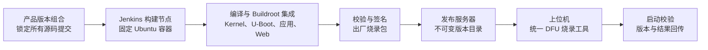

# Jenkins 整机固件构建、发布与首次烧录流水线建议

日期：2026-11-11。状态：方案建议，尚未接入 Jenkins 或发布服务器。首期目标：Beta 研发固件的首次整体烧录闭环。本文件不表示已经具备生产放行条件。

## 1. 推荐架构

以 Buildroot 作为整机固件集成入口，在其仓库维护 Jenkinsfile、产品版本组合和打包入口。Jenkins 调度 Linux 构建节点，节点启动固定版本的 Ubuntu 构建容器。最终发布签名的出厂烧录包，由上位机调用统一烧录工具执行 DFU，启动后核对版本并回传结果。



首版采用一个产品构建 Job，先手动触发，只支持 CS96-beta 的已确认硬件配套。固件按机型收敛，应用编译完整功能；当前硬件验收范围仍以已经确认的点云模式 1/2 为准，不重新扩展为机型乘以数据模式的多套流水线。

Jenkinsfile 和构建脚本应进入版本管理；本文属于讨论文档，当前不提交。Docker Pipeline 支持使用容器作为构建环境，Jenkinsfile 可跟随源码评审与追溯。[Jenkinsfile 官方说明](https://www.jenkins.io/doc/book/pipeline/jenkinsfile/)、[Docker Pipeline 官方说明](https://www.jenkins.io/doc/book/pipeline/docker/)

## 2. 先固定一份真正完整的版本组合

Kernel 与 you_see_arm 不能单独描述一份完整固件。建议收敛以下来源：

| 来源 | 必须记录的内容 |
| --- | --- |
| Buildroot | 仓库提交、有效 defconfig、BusyBox 配置、overlay、post-build/post-image |
| Kernel | 仓库提交、内核配置、设备树、补丁及编译输出 |
| U-Boot | 仓库提交、配置、启动读取范围、DFU 目标和实际烧录脚本 |
| you_see_arm | 仓库提交、机型、编译选项、应用发布清单 |
| 应用依赖 | cc、driver、算法等子模块的固定 gitlink 提交 |
| you_see_www | 父仓库及 CGI/前端子模块提交、前端 lock 文件 |
| 工具与资源 | Ubuntu 构建镜像摘要、工具链、motor 程序等预编译资产的来源与 SHA256 |

建议增加产品锁定文件，例如 `board/ti/lidar/products/CS96-beta.lock.yaml`。正式发布选定一份经过确认的版本组合；研发构建可以选择分支，但在构建开始时就将所有引用解析成完整提交号，保存为 `source-lock.resolved.json`，随后按这些提交构建。

子模块按父仓库记录的提交检出；构建过程中不再执行 git pull 或追踪移动的分支，也不临时切换工具链、驱动分支。Jenkins 构建编号用于追踪任务，产品发行编号用于标识固件，二者分别记录。

当前本机保存的 Buildroot defconfig 仍引用 Kernel/U-Boot 的 `main`，post-build/post-image 配置为空，不能据此认定它已经等同于同事烧录到 30 的最新配置。第一步应取得同事这次实际成功构建的配置、集成脚本和 DFU 烧录流程，作为基线。

## 3. Ubuntu 构建环境

先复用同事已经成功构建固件的 Ubuntu 和工具链组合，再制作版本化构建镜像，按容器镜像摘要固定。镜像中预装明确版本的编译工具、CMake、Ninja、Python、Node/npm、OpenSSL 和主机制镜像工具；构建时不依赖临时交互安装。

- Jenkins controller 负责调度和记录，重编译在专用 Linux agent 执行。
- 编译容器使用普通构建用户，工作目录固定，避免生成无法被 agent 管理的 root 属主文件。
- 容器与 agent 需能访问内部 Git 和发布服务器；SCM 凭据与已核对的主机公钥由 CI 环境提供，不写进容器镜像。
- 下载缓存、npm 缓存和合适配置的 ccache 可以持久化；每次发布构建使用独立输出目录，首版不共享不同版本的 Buildroot output/target。
- 工具链和配置发生变化时不能盲用旧编译结果。优先保证来源可追溯、能够重新构建，再逐步验证产物是否达到位级可重复。

前端已有 package-lock.json，CI 使用匹配项目要求的固定 Node/npm 和 `npm ci`。具体 Node 版本先以项目实际依赖要求和成功构建环境确认，不直接选择随时间变化的 latest。

## 4. 推荐流水线阶段

| 阶段 | 工作及产出 |
| --- | --- |
| 1. 选择并锁定版本 | 选择产品与研发/发布渠道，解析全部提交和配置摘要，生成源码锁定记录 |
| 2. 检出与环境检查 | 检出确定提交及子模块，记录容器和工具链版本，检查输入是否完整 |
| 3. 构建内核与底层配套 | 由 Buildroot 的同一配置构建 Kernel、DTB、U-Boot、内核模块及主机制镜像工具 |
| 4. 构建应用与 Web | 编译完整 Beta 应用、用户态驱动、管理工具、CGI 和前端 |
| 5. 生成应用签名包 | 生成应用 manifest，记录版本、能力和依赖，按渠道签名 |
| 6. 准备系统集成 | 整理 overlay、可信工具、公钥、选定 .ko、motor 和第三分区应用目录 |
| 7. 完成系统镜像 | Buildroot 合入 overlay，post-build 完成配置与启动入口检查，再生成根文件系统 |
| 8. 生成出厂产物 | 根据确认的配方生成系统 FIT、user.jffs2，收集实际 Bootloader 文件 |
| 9. 校验与整包签名 | 检查架构、依赖、分区容量及写入范围，生成并签名整机烧录清单 |
| 10. Jenkins 归档 | 保存最终包、配置、版本组合、日志和测试报告 |
| 11. 发布候选版本 | 上传不可变版本目录，核对完整性后才发布下载索引 |
| 12. 烧录与结果反馈 | 上位机下载、验包、烧录、启动检查并记录结果；属于后续独立执行环节 |

首版顺序执行，先保证可复现人工成功流程。稳定后再将无依赖的编译阶段并行化。Jenkinsfile 主要组织阶段，具体构建、制镜像、校验和上传逻辑放在可单独运行的仓库脚本里，避免只能在 Jenkins 页面中调试。

现阶段可按“先准备内核及主机工具、编译应用，再生成 overlay，最后完成 Buildroot 镜像”的顺序组织。工具链沿用已经验证的组合并固定来源，核对应用和系统运行库 ABI；后续可逐步收敛为 Buildroot 软件包依赖关系。

post-build 处理的是打包前的目标目录；需要最终镜像文件的组合步骤放在 post-image 或明确的最终制包步骤中。Buildroot 提供这两类扩展点，不应在它们内部再追踪最新源码或自动发布产品。[Buildroot 官方手册](https://buildroot.org/downloads/manual/manual.html#rootfs-custom)

## 5. 需要调整的现有入口

| 当前情况 | 接入 CI 前的处理 |
| --- | --- |
| Web output.sh 会 checkout、clean、git pull，并使用 npm install | 拆出不修改源码版本的构建入口，使用锁定提交与 npm ci；CI 不直接原样调用旧脚本 |
| Beta 测试制包默认读取历史 Web tar.gz | 改为显式接收本次 Web 构建输出，防止应用更新但网页仍来自旧包 |
| 测试制包入口固定 release=false | 为正式发布提供明确入口，检查批准的版本组合与发布状态，不只改文件名 |
| 当前 .ko 由 file 目录提供 | Kernel 仓库存在自研雷达驱动源，需同事确认配置并从本次内核构建输出取得配套 .ko |
| motor 曾从 221 读取 | 提供源码或内部版本化资产，记录摘要；CI 不临时登录某台雷达取依赖 |
| 开发包带有 221 标定 | 通用出厂包不内置单台设备标定，也不包含已运行的 state.json |
| 上位机缺少整机发行标识 | 定义可查询的整机发行编号，避免只靠内核版本或应用 version=null 判断烧录结果 |

这些是构建入口的收敛工作，不要求先完成在线 OTA、SN 写入或网络自动配置。

## 6. 出厂烧录包约定

推荐“一个可下载包，内部包含多个实际烧录文件”，不强制拼成覆盖整片 Flash 的单一 img。以下为目录建议，Bootloader 和系统文件名以现有成功烧录流程为准：

```text
CS96-beta_factory_<发行编号>/
  factory-manifest.json
  factory-manifest.sig
  images/
    <实际需要的 Bootloader 文件>
    linux.itb                         系统镜像，示意名称
    user.jffs2                        第三分区初始镜像
  provenance/
    source-lock.resolved.json
    build-configs/                    实际配置和构建环境记录
  reports/                            构建及校验结果
  SHA256SUMS
  release-notes.md
```

先前的 beta-image-test 集成包是给镜像同事整理系统用的输入材料；这里的 factory 包是给上位机直接烧录用的最终产物。factory 包主要包含普通镜像文件与清单，Linux 权限和符号链接已经封装在镜像内部，上位机不需要在 Windows 上还原 overlay，也不需要处理那些绝对路径符号链接。

整机清单与应用包内部 manifest 是两层用途。整机清单描述产品、硬件配套、发行编号、组件文件、大小、SHA256、布局版本、实际 DFU 目标及烧录后预期标识；应用 manifest 继续描述该应用版本和能力。

清单中的 DFU 目标、介质、偏移、长度和次序必须来自同事已经确认的 U-Boot/烧录脚本，不能根据文件名或 Linux mtd 编号猜测。需要区别下载引导程序到 RAM 与真正写入持久 Flash，也要明确偏移的单位。

通用 user.jffs2 只带应用、通用配置及必要目录，不放任何设备的 SN、标定或历史运行状态。首次设备个体化由独立产测步骤完成；当前 SN/个体化功能尚未正式交付。

出厂初始化会覆盖第三分区，已有标定与配置的设备不能将其当作日常升级包使用。SN 分区默认保持不写，范围检查应阻止烧录文件越界。FPGA 的 .bit 仍沿用当前 JTAG 工序，只在清单中记录兼容配套，不混作 ARM Flash 分区镜像。

建议在系统镜像内放一个只读的整机发行信息文件，并提供查询接口，记录发行编号和来源组合。最终镜像 SHA256 放在外层烧录清单中，不将系统镜像自身的最终摘要嵌回镜像内部形成循环。

## 7. 归档、签名和发布

Jenkins 归档用于关联构建日志与产物，可使用 archiveArtifacts；发布服务器负责长期保存和上位机下载。Jenkins 的 fingerprint 用于构建关联追踪，不替代 SHA256 或发布签名。[Jenkins 归档说明](https://www.jenkins.io/doc/pipeline/steps/core/)

发布目录建议按产品、渠道、不可变发行编号划分。先上传完整候选目录，完成服务端完整性检查，再更新下载索引或完成标记；上位机只展示已经发布完整的版本。latest 如需提供，只作为索引，不覆盖某个旧版本包的内容。

发布服务器的上传协议、认证和下载索引需与现有网站对接，不预设必须更换存储服务。首版优先沿用现有发布站，明确上传接口、完成发布语义和客户端查询格式即可。

私有 Git 凭据、发布令牌及签名私钥通过 Jenkins Credentials 或既有签名服务提供；不进入源码、容器镜像、构建日志或发布包。研发与正式发布使用不同信任范围，正式签名与发布仅允许经过授权的构建路径访问，不能仅靠任意分支中的 Jenkinsfile 自行声明“正式构建”。上位机通过预置信任的公钥验包，不自动信任下载包自带的公钥。[Jenkins 凭据说明](https://www.jenkins.io/doc/book/security/credentials/)

同一发布渠道使用明确、可追溯的签名 key ID，并保持与设备信任公钥配套；不在每次 CI 构建时临时生成一套新签名身份。公钥轮换另行设计交付流程。

## 8. 上位机首次烧录功能

建议将实际烧录能力做成可单独调用的工具或模块，再由上位机提供交互界面。这样研发手动操作、上位机以及未来自动台架可以复用同一实现。

目标流程：

1. 选择产品与候选版本，下载完整出厂包。
2. 校验整机清单签名、所有文件摘要及目标硬件配套。
3. 识别目标板并按现有 DFU 流程进入烧录阶段。
4. 按清单规定的实际目标、次序和范围写入，保护 SN，并区分首次初始化与已有设备维护。
5. 在支持的后端执行读回校验；传输成功不直接等同于固件验收成功。
6. 设备启动后，通过当前可用的串口或已知网络地址核对发行编号、应用包校验、存储挂载与服务状态。
7. 保存并回传烧录结果：临时工装编号或后续真实 SN、硬件型号、目标发行编号、结果与日志。

首版不依赖尚未实现的 Link-Local/mDNS 自动发现，也不顺带开发 SN 写入。30 是 ARM 开发板，应明确其验收范围；烧录启动通过不能自动标记为真实雷达采集通过或生产放行。

## 9. 首版范围与完成标准

第一版只做：手动触发 Jenkins → 固定 Beta 版本组合 → Ubuntu 容器构建 → 签名归档并发布候选包 → 上位机调用统一工具完成一次初次烧录 → 启动后核对同一个发行编号并记录结果。

完成标准：

- 从干净检出构建，不借用个人电脑的输出目录、历史 Web 包或设备内文件。
- 可追溯完整来源组合、配置、构建环境和签名记录。
- 发布服务器上的包与 Jenkins 归档一致，上传未完成的版本不会出现在可烧录列表。
- 上位机使用这一份包完成已约定测试板的烧录与启动验证。
- 构建成功、发布完成、烧录启动通过、功能验收通过、生产放行分别记录。

后续再增加代码提交触发、更多机型、增量构建优化、自动上板和应用 OTA。自动上板应使用独立台架 Job，锁定专用 USB/串口资源，并复用同一个烧录工具；不让普通构建任务直接连接正在使用的雷达。[Jenkins 资源锁说明](https://www.jenkins.io/doc/pipeline/steps/lockable-resources/)

## 10. 接下来先做的三件事

1. 收齐同事这次成功构建并烧录的 Buildroot/Kernel/U-Boot 配置、overlay 和 DFU 流程，固定成 Beta 基线。
2. 定义整机发行编号、版本锁定文件及出厂包清单，和上位机同事共同确认输入输出。
3. 在固定 Ubuntu 容器中打通一个无需 Jenkins 的、无交互的整机构建入口；本地跑通后，Jenkins 调用同一入口并负责归档、签名权限与发布。

这三项完成后再接 Jenkins，可将容器、源码、打包和发布问题分开定位。当前的开发板验收脚本还在本地未提交；若后续纳入 CI，应先评审并提交所需测试代码，不能让 Jenkins 依赖个人工作区。
