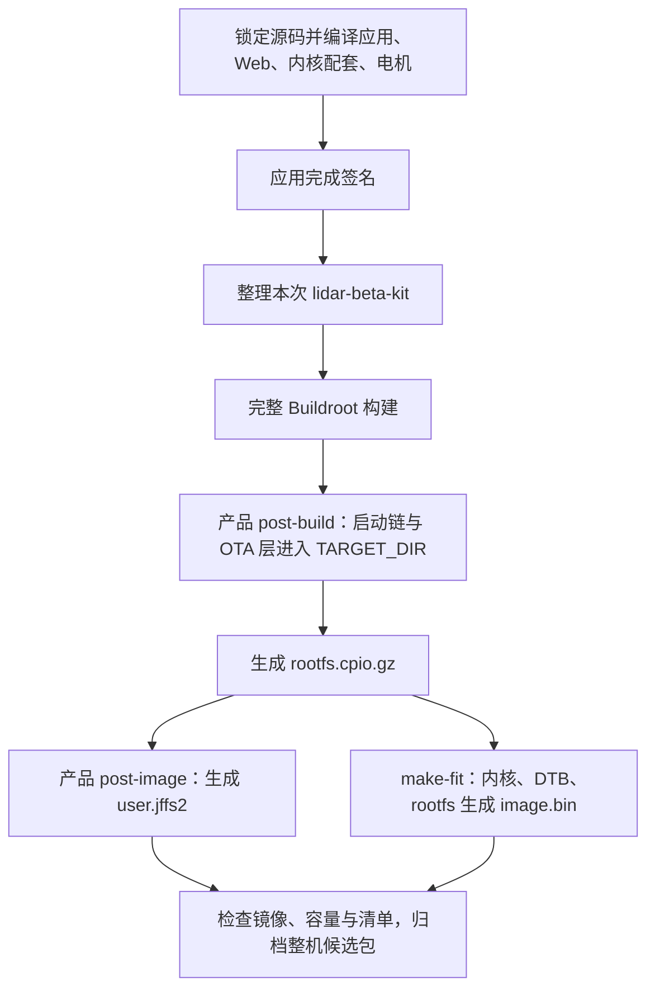

# Jenkins 首轮产物核查与镜像集成补齐

日期：2026-11-12。交接给 Jenkins 流水线开发人员使用。本文基于实际归档及其中记录的源码提交核查；没有修改 Jenkins、Buildroot 工作区或设备，没有执行烧录。

## 本轮结论

检查文件：`dist/archive.zip`，对应 `CS96-beta-application` 第 7 次构建，发行编号 `20261112T004729Z-096a5bbc8dc9`。

这一轮完成了应用和底层组件构建，尚未完成整机固件构建。没有执行完整 Buildroot 构建，因此没有触发其产品 post-build/post-image，也没有生成 rootfs、系统 FIT 和第三分区镜像。

| 内容 | 实际结果 |
| --- | --- |
| 应用包 | 有 `you_see`、`lidar_mgrd`、`lidar_mgrctl`、`lidar_boot`、`lidar_crypto`、`liblidar.so`、配置、业务 Web/CGI 和签名清单，共 189 个普通文件 |
| 系统组件 | 有 `Image.gz`、DTB、`yousee_lidar.ko`、`u-boot.img`、`tiboot3.bin`、`tispl.bin` 及配置记录 |
| 已生成的系统 overlay | 没有；`S35lidar_storage`、`S90lidar_web`、`S98lidar` 和 `lidar-service` 等均未作为部署文件收入归档 |
| 电机程序 | 没有；本轮应用锁定 `096a5bbc8dc90ba8fb1faf189f03e72cbe4797b0`，早于电机源码提交 |
| 根文件系统、系统 FIT、`user.jffs2` | 均没有；`Image.gz` 只是压缩内核，不能代替包含根文件系统的完整系统 FIT |
| 烧录就绪状态 | 清单明确标记 `factory_ready=false`、`rootfs_included=false`、`user_jffs2_included=false` |

外层 `SHA256SUMS` 的 7 项及集成清单的 211 项文件大小/摘要均一致。该结果仅证明归档与所附摘要一致；本次没有取得包外信任公钥，未独立验证签名身份。

应用包本来就不负责携带系统启动脚本。最终出厂包也可以只带镜像文件；届时应确认脚本已经进入镜像内部，不能仅凭外层压缩包里有没有 `overlay/` 判断。

## 为什么没有执行 post-build

归档附带了真实 CI 脚本：

- `provenance/ci/Jenkinsfile.application` 只调用 `candidate.py` 的应用/Web 构建与签名，以及 `components.py` 的组件构建与集成输入包归档。
- `components.py build` 调用 Buildroot 的 `host-libopenssl` 目标，随后独立执行 Kernel 和 U-Boot 编译。
- `components.py package` 只合并 `staging/application`、`staging/system-components` 与来源记录，没有生成产品 kit，也没有继续完整 Buildroot 构建。
- `make-fit.py` 已有实现，但此 Jenkinsfile 没有调用它，且本轮没有生成它所需的 `rootfs.cpio.gz`。

所以，需要补上从“组件产物”到“产品镜像”的集成阶段。仅重跑现有 `components.py package` 不会产生系统镜像。

## Buildroot 已经具备的接入点

已只读核对本轮锁定提交 `cc60c641b83c902032075c2a2a6ebd80f8c5895f`，不是本机旧 `main` 快照：

```text
BR2_ROOTFS_OVERLAY="board/ti/overlay"
BR2_ROOTFS_POST_BUILD_SCRIPT="board/ti/ota/post-build.sh"
BR2_ROOTFS_POST_IMAGE_SCRIPT="board/ti/ota/post-image.sh"
BR2_PACKAGE_HOST_MTD=y
```

该提交的 BusyBox 配置也已经开启 `CONFIG_RUNSV=y`、`CONFIG_RUNSVDIR=y`、`CONFIG_SV=y`。

`board/ti/ota/post-build.sh` 接收离线 `TARGET_DIR`，从 `CS96_BETA_KIT` 获取产品 kit，调用 kit 内 `tools/post-build.sh` 合入基础启动链，再安装已有 SWUpdate 配置、证书与恢复脚本。未设置变量时，它默认查找 Buildroot 仓库旁的 `lidar-beta-kit`，CI 不应依赖这个隐式目录。

`board/ti/ota/post-image.sh` 同样读取 `CS96_BETA_KIT`，使用 Buildroot host 侧 `mkfs.jffs2` 和 `build-user-jffs2.py` 生成 `output/images/user.jffs2`。

应保留这两个产品 hook，通过环境变量传入本次生成的 kit，不要将它们替换成只执行应用仓库 post-build 的新入口，否则会丢失同事已经接入的 OTA 层。

post-build 在根文件系统镜像生成前处理 `TARGET_DIR`；post-image 在文件系统镜像生成后运行。配置了 hook，不代表只执行某个主机工具或内核目标时也会触发。[Buildroot 官方手册](https://buildroot.org/downloads/manual/manual.html#rootfs-custom)

## 电机程序的确定来源与编译方式

| 项目 | 确定值 |
| --- | --- |
| 仓库 | `git@10.42.0.10:ys_embedded_software/you_see_arm.git` |
| 分支 | `dev/fs_sdk`；构建开始时解析为固定提交 |
| 引入提交 | `ad6efb0ed57ddea253af42f4e4b3e487cca65724`，已经推送 |
| 源码 | `platform/beta/motor/demo_i2c_motor.c` |
| 构建定义 | `platform/beta/motor/CMakeLists.txt` |
| CMake 目标 | `demo_i2c_motor` |
| Beta 构建产物 | `build/beta/platform/bin/demo_i2c_motor` |
| 系统安装路径 | `/usr/libexec/lidar/platform/demo_i2c_motor` |
| 安装组件 | `lidar_platform`，需要显式选择；普通应用安装不包含它 |

更新版本锁，使用该提交或包含其变更的后续提交。新提交的 Beta 全量构建会同时编译电机程序，所以现有 `candidate.py build-app` 更新源码后也会生成它。接着显式检查并安装平台产物，例如在已有 CI 工作区执行：

```bash
app="$WORKSPACE/src/you_see_arm"
cmake --build "$app/build/beta" --target demo_i2c_motor --parallel 6
test -x "$app/build/beta/platform/bin/demo_i2c_motor"
cmake --install "$app/build/beta" --component lidar_platform \
  --prefix "$WORKSPACE/staging/platform-overlay"
```

以上命令以本轮已经完成 Beta 配置/构建为前提。也可单独编译，见 [Beta 电机程序说明](../platform/beta/motor/README.md)。

生成 kit 时，将该二进制作为 `motor_init` 输入；记录源码提交、机型、工具链、二进制 SHA256 和架构。不要继续从雷达、旧测试包或 `dist/demo_i2c_motor.c` 获取来源。`factory_inputs_pending` 中的电机项应在实际构建与校验成功后更新。

新源码的错误退出和等待超时已修正，设备调用路径兼容；尚需 Beta 实机验证，不能直接标记硬件验收完成。

## 生成本次产品 kit，再继续 Buildroot

下一阶段建议沿用当前锁定源码、应用/Web 构建和签名流程，增加一个接收“本次已签名应用”的 kit 整理入口。使用以下输入：

- `staging/application`：`candidate.py package` 已完成签名的完整应用与 Web，后续不能再修改其中的文件内容。
- 本次构建的 `yousee_lidar.ko` 和电机程序；不能从应用仓库历史 `file/` 目录取旧 `.ko`。
- CI 预置信任公钥，必须与该应用签名配套；私钥不进入 kit 或目标系统。
- 当前应用源码的启动模板和集成工具。

可复用的代码与输出职责：

| 来源 | 用途 |
| --- | --- |
| `deploy/runit/rootfs/` | 启动、存储、监督、Web 和 Beta 平台脚本模板 |
| `deploy/runit/beta.boot.json`、`inittab.fragment` | 机型管理配置和需要合并的监督入口 |
| `scripts/prepare_boot_bundle.py:create()` | 验证签名应用、绑定模块构建标识、补齐可信二进制/公钥/电机，并整理初始版本目录 |
| `scripts/prepare_beta_image_kit.py:recovery_web()` 及其目录整理逻辑 | 系统只保留诊断 Web；业务 Web 在第三分区，验签后复制到 RAM |
| `scripts/integrate_lidar_rootfs.py` | 合入离线根文件系统、合并 inittab、处理旧入口和链接 |
| `scripts/beta_image_tools.py` | kit 清单、完整性与应用签名检查 |
| `deploy/beta-image/post-build.sh` | kit 的 `tools/post-build.sh`，检查监督工具和基础运行库 |

kit 至少生成 `overlay/`、`third-partition/`、`tools/`、`kit-report.json`、`SHA256SUMS`，与 Buildroot 产品 hook 约定一致。完整目录样例见 [Beta 镜像集成流程](../deploy/beta-image/集成流程.md)。

当前 `prepare_beta_image_kit.py` CLI 会重新编译应用、读取 `--web-archive`，且默认值仍指向历史 Web 包，不能原样作为上述“消费已签名应用”入口。需要扩展接口或抽出整理函数，明确传入本轮产物；不要虚构现有 CLI 已有 `--application` 参数，也不要重做另一份与本轮签名包不一致的应用。

最终 overlay 应包含三个 `S35/S90/S98` 脚本、`lidar_boot`、`lidar_crypto`、`lidar-service/storage/web/platform-beta`、runit 模板、配置、公钥、指定 `.ko`、电机和诊断 Web；inittab 由集成工具合并。普通业务 Web 和 `you_see` 从第三分区加载，不再复制成第二套默认应用。

准备好 kit 后，在正常 Buildroot 构建中显式传入绝对路径：

```bash
# 以下路径必须是当前 Jenkins 工作区实际生成的目录。
export CS96_BETA_KIT="$WORKSPACE/staging/lidar-beta-kit"
make -C "$WORKSPACE/src/buildroot" O="$WORKSPACE/build/system" \
  HOSTCC=/usr/bin/gcc-13 HOSTCXX=/usr/bin/g++-13
```

上述示例要求 `build/system/.config` 已先由产品 defconfig 生成，锁定 Kernel/U-Boot 提交、补丁、工具链及实际配置。不得复用其他发行的 `output/target`，也不能把另一次独立内核构建的 `.ko` 与不一致的 Buildroot 内核混装。

随后调用已有 `make-fit.py`，按 `board/ti/image.cfg` 将本次 `Image.gz`、DTB、`rootfs.cpio.gz` 制成 `image.bin`。当前 `post-image.sh` 的职责是生成 `user.jffs2`，不能假定它也完成了 FIT。



## 必须处理的标定检查差异

当前 Buildroot 的 `post-build.sh` 和 `build-user-jffs2.py` 均调用 `beta_image_tools.py check --ready`。该选项要求电机和本机三个标定文件齐备，适用于某台雷达的采集准备检查。

通用出厂镜像不能包含 221 或其他设备的标定、SN、历史 `state.json`。因此需要分别定义：

- 通用镜像集成检查：应用签名和摘要、启动文件、匹配内核/电机、基础依赖、布局与容量必须通过；标定目录可以为空，标记待单机产测个体化。
- 单机采集就绪检查：额外要求该设备自己的标定和必要硬件配套齐备，继续使用严格的就绪判定。

调整 hook 时保留完整性与可信资产检查，增加明确的“通用出厂”检查语义；不能仅删除所有检查，也不能从旧 kit 复制某台设备标定来凑齐。通用镜像构建成功不等于雷达可以开始采集。

## 下一轮 Jenkins 应有的完成检查

1. 锁定的应用包含电机源码及目标，电机是本轮 AArch64 编译产物，记录摘要并进入系统平台目录。
2. kit 使用本轮已经签名的应用/Web，归档来源与 kit 摘要；不依赖历史 tar.gz 或雷达内文件。
3. 日志出现产品 post-build 和 post-image 的执行记录；在最终 `rootfs.cpio.gz` 中检查启动脚本、运行权限、链接和 inittab 监督入口。
4. 检查最终 rootfs 的 runit applet 与动态库，内核和 `.ko` 必须配套；测试缺少电机或 kit 时构建确实失败。
5. `image.bin` 包含本轮 kernel/DTB/rootfs，`user.jffs2` 包含本轮应用版本与正确 current 链接；检查实际镜像容量与已确认分区布局。
6. 当前脚本将 `user.jffs2` 填充到 `0xff0000` 字节；保留 SN 区域。通用镜像检查不含单机标定、SN 和历史状态。
7. 整机候选包可同时保存两个最终镜像及配套引导文件、来源锁、配置、摘要和检查报告；Windows 烧录端不必展开 Linux overlay 的符号链接。
8. 完整镜像构建通过后仍标记硬件验收待完成。DFU 的介质、目标、偏移和次序未确认前，不标记“可直接出厂烧录”。

缺少必需镜像、hook 执行失败或校验失败时，应让整机 Job 失败。可以继续保留当前应用 Job，用不同 scope 表明“应用构建完成”和“整机镜像构建完成”，避免沿用成功提示造成误解。[Jenkins 失败处理说明](https://www.jenkins.io/doc/book/pipeline/jenkinsfile/#handling-failure)

## 仍需交接的资料

- `/opt/jenkins-agent/ci` 和 `Jenkinsfile.application` 的实际维护仓库/版本；归档内有审查副本，本次没有修改服务器上的脚本。
- 已成功使用的 DFU 流程、`dfu_alt_info`、介质与写入范围；镜像生成可以先做，暂不推测烧录目标。
- 如 Buildroot 同事在本轮锁定提交之后又有集成改动，应先更新并核对，再纳入下一份版本锁。

本次详细归档检查记录保存在本机 `build/jenkins-archive-audit-20261112/归档检查.json`，CI 脚本审查副本也在该目录中。
