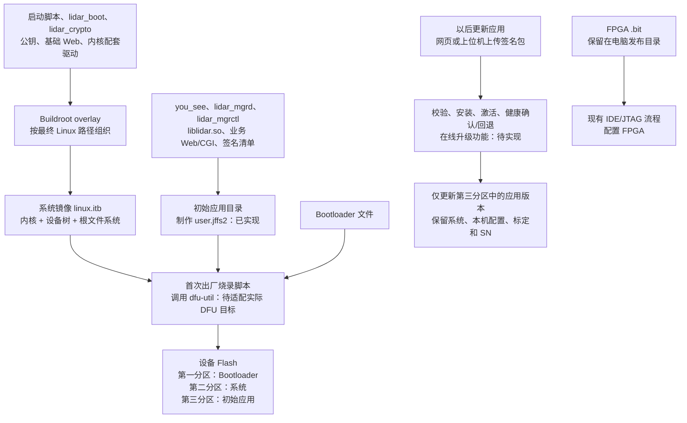

# 系统镜像与应用独立更新交付边界

本记录明确后续集成方向；不表示在线升级器已经实现。当前没有修改 Buildroot、分区或设备。

## 先看首次烧录与后续升级

用户确认目前使用 `dfu-util-0.11-binaries`。推荐的产品交付流程如下，其中 `linux.itb` 为示意文件名，由系统同事构建；`user.jffs2` 的生成工具已经实现。



首次出厂可以由一个脚本连续写入多个文件，操作员执行一次。底层分别写各区域，不要求拼成一个覆盖整片 Flash 的 `.img`。新设备还需要独立完成本机标定和第四分区 SN 的出厂写入；这两类数据不能从另一台雷达复制。

现有 `board/ti/image.cfg` 只打包内核、DTB、RAM 根文件系统，不含第三分区。`.img` 后缀不能证明包含整片 Flash；例如 TI DFU 流程中的 `u-boot.img` 也只是引导程序文件。

基础工具 `prepare_boot_bundle.py` 生成系统 `rootfs-overlay` 与初始化归档 `flash-seed.tar.gz`。新的完整交付工具 `prepare_beta_image_kit.py` 则整理 `overlay`、`third-partition`、原始 Web 与驱动参考文件，并调用 `beta_image_tools.py` 制作实际 JFFS2 镜像；不能把 tar.gz 直接当作 JFFS2 镜像写入 Flash。具体 DFU 烧录脚本仍需系统同事按实际 U-Boot 配置适配。

`dfu-util` 是电脑端的 USB DFU 工具。设备端的 DFU 目标决定数据进入 RAM、串行 Flash 或其他介质；首次 DFU 传送引导程序到 RAM，和之后写入持久 Flash，是不同步骤。还需核对现有烧录脚本及 U-Boot 的 `dfu_alt_info`，确认已开放哪些目标及范围，不能假设当前配置已经能写第三分区。

参考：[dfu-util 官方手册](https://dfu-util.sourceforge.net/dfu-util.1.html)、[U-Boot DFU 说明](https://docs.u-boot.org/en/latest/usage/dfu.html)、[TI USB DFU 烧录流程](https://git.ti.com/cgit/processor-sdk/uboot-flash-writer/tree/tools/DFU_flash/README.md)。

## deploy 中哪些内容进入 overlay

不能将整个 `deploy` 目录直接放进 overlay。应使用离线工具生成补齐目标二进制、公钥、机型配置和驱动标识的 `rootfs-overlay`，再合并其内容到 Buildroot 的 `board/ti/overlay`。原有 SSH 等文件保留。

```text
生成的 rootfs-overlay/etc/...  → board/ti/overlay/etc/...
生成的 rootfs-overlay/usr/...  → board/ti/overlay/usr/...
```

`deploy/runit/rootfs` 只是模板来源；`beta.boot.json` 需要成为目标 `/etc/lidar/boot.json`，`inittab.fragment` 需要合并到原 `/etc/inittab`。README、验收记录及主机 Python 工具不用装入目标系统。已有离线合入工具负责合并 inittab、保留旧入口备份和拒绝冲突，可纳入 post-build。启动顺序由 rcS、SNN 脚本和 inittab/runit 共同决定，不能只靠把文件复制进 overlay。

## 交付边界

产品分为基础系统和按机型发布的完整应用包。首次出厂分别写入系统镜像和第三分区初始应用包；后续应用更新写第三分区，并受控重启相关服务，不要求重刷整个 Linux 系统。采集服务重启期间数据会中断，不承诺连续采集更新。

| 内容 | 最终归属 | 更新方式 |
| --- | --- | --- |
| 内核、设备树、BusyBox、基础依赖、网络服务 | 系统镜像 | 系统升级 |
| `lidar_boot`、`lidar_crypto`、发布公钥、服务监督和存储脚本 | 系统镜像 | 系统升级，作为应用之外的可信入口 |
| 可信应用安装、版本选择及失败恢复入口 | 系统镜像 | 后续开发，不能仅依赖正在被更新的 `lidar_mgrd` |
| `you_see`、`lidar_mgrd`、`lidar_mgrctl`、统一 `liblidar.so` | 第三分区版本目录 | 签名应用包升级 |
| 业务网页、与该版本配套的 CGI | 第三分区版本目录 | 后续纳入同一签名应用包，与管理服务配套升级 |
| lighttpd 运行时、固定基础配置及最小诊断入口 | 系统镜像 | 系统升级；诊断入口不能依赖损坏的业务包 |
| `yousee_lidar.ko`、电机初始化程序 | 当前阶段随系统镜像 | 与指定内核配套，不作为任意应用更新资产 |
| FPGA 逻辑 | 当前仍由 IDE/JTAG 烧录 | 暂不纳入应用在线更新 |
| 本机标定、用户设置、模式与升级事务状态 | 第三分区独立数据目录 | 应用升级不能覆盖 |
| SN | 第四分区 | 出厂写入，应用更新不修改 |

系统 overlay 按最终根目录组织上述系统文件。例如 `board/ti/overlay/usr/libexec/lidar/lidar_boot` 会进入目标系统的 `/usr/libexec/lidar/lidar_boot`。第三分区的应用包单独生成，不需要再把整套应用放入 rootfs，形成两份默认运行来源。

当前发布包包含 `lidar_boot`、`lidar_crypto` 构建产物，但实际可信启动使用系统预置副本；包内副本不会自动更新系统信任入口。后续整理交付清单时应明确这种区别。

## 第三分区布局与更新目标

```text
/mnt/mtdblock2/lidar/
  releases/<版本>/
    bin/                        应用与管理程序
    lib/                        统一用户态驱动库
    www/                        后续纳入的业务网页和 CGI
    manifest.json
    manifest.sig
  current -> releases/<版本>
  config/                       本机配置和用户设置
  calibration/                  本机标定
  state/                        模式状态和后续升级事务记录
```

下一阶段实现应用更新闭环：接收上传 → 空间及机型、系统兼容性检查 → 校验签名和全部文件 → 写入新版本目录并完成持久化 → 受控停服 → 持久记录候选版本和回退版本 → 激活候选版本 → 重启管理、采集及相关 Web 组件 → 健康确认后提交；超时或异常恢复旧版本。掉电恢复同样依赖持久事务记录，不能只创建一个 `current` 链接就认为完成。

使用同一第三分区内的版本目录保留当前和回退应用，不要求立即增加物理 A/B 分区。这提供应用级回退，不能恢复损坏的 Linux 镜像或整个 JFFS2 文件系统。上传暂存可使用容量受控的 RAM；Flash 预算仍应覆盖新旧版本、标定配置、文件系统开销及垃圾回收余量。状态格式升级也必须考虑旧程序能否回退读取。

模式切换只改变同一应用版本的运行模式；应用升级改变软件版本。两者互斥，但分别记录事务，不能混用最后确认模式与最后确认版本。

## 当前已完成与缺口

- 已有统一 Beta 应用、运行时模式管理、签名验包、可信启动、服务监督及离线集成工具。
- `prepare_boot_bundle.py` 已分别输出 `rootfs-overlay` 和 `flash-seed.tar.gz`。后者仅用于首次受控初始化，不能当作在线升级器覆盖已有部署。
- 新完整交付入口已将业务 Web/CGI 纳入签名版本目录。`lidar_boot package-path` 验签后返回固定版本路径，`lidar-web` 将其复制到 RAM，`S90lidar_web` 启动；损坏包使用系统预置诊断页。旧升级、目录切换等 CGI 在此测试包中禁用。基础 `prepare_boot_bundle.py` 仍兼容原系统 `/www` 布局。
- 在线上传安装、候选版本激活、管理服务自身更新、升级失败回退和断电恢复尚需开发与验收。
- Beta 当前仍只开放已验证的 `work_mode 1/2`；直方图、灰度及真实硬件停采配套不因目录调整自动完成。

## 已核实的 Buildroot 与分区信息

2026-11-06 检查本机 `/home/huyidao/workspace/buildroot_ti_am6204`：

- 保存配置 `configs/buildroot_lidar_defconfig` 指定 `BR2_ROOTFS_OVERLAY="board/ti/overlay"`、BusyBox init；当前 overlay 仅有 SSH 配置。
- Buildroot 目录没有 `.config`、`output`，不能把保存配置等同于同事正在构建的有效配置。
- 内核来源是 `git@10.42.0.10:ys_kernel/linux_ti_am6204.git`，选择 `k3-am62-lp-sk.dts`；`board/ti/image.cfg` 引用编译后的 `arch/arm64/boot/dts/ti/k3-am62-lp-sk.dtb`。
- 用户随后提供本机内核目录 `/home/huyidao/workspace/linux_ti_am6204`，已找到 `arch/arm64/boot/dts/ti/k3-am62-lp-sk.dts` 第 235 行起的 Flash `partitions` 节点，采用 `fixed-partitions`。四个分区的起始偏移和大小分别为：boot `0x0/0x200000`、linux `0x200000/0xe00000`、user `0x1000000/0xff0000`、sn `0x1ff0000/0x10000`，与此前 221 实机一致。“设备数”确实应指“设备树”。U-Boot 的启动读取范围和 DFU 配置仍需另外核对。
- `board/ti/image.cfg` 描述包含内核、DTB、`rootfs.cpio.gz` 的 FIT 镜像，不是四个 Flash 分区的定义文件。
- 保存的 `package/busybox/busybox.config` 中 `CONFIG_RUNSV/CONFIG_RUNSVDIR/CONFIG_SV` 仍未启用；同事构建时需要确认有效配置及最终 applet。

此前 221 实机读取的 32 MiB Flash 布局为：

| 序号 | Linux 节点 | 用途 | 大小 |
| --- | --- | --- | --- |
| 第一分区 | `/dev/mtdblock0` | boot | 2 MiB |
| 第二分区 | `/dev/mtdblock1` | linux | 14 MiB |
| 第三分区 | `/dev/mtdblock2` | user，JFFS2 | 15.9375 MiB |
| 第四分区 | `/dev/mtdblock3` | sn | 64 KiB |

现有第三分区已经可以承载独立应用，不以调整分区为前提。最终是否缩小第二分区、扩大第三分区，应按实际系统 FIT 镜像和完整应用新旧两版占用测量后决定，不能只比较 `you_see` 或压缩上传包大小。

如果需要调整第二、第三分区边界，应同步修改设备树、U-Boot 读取及烧录布局，按 Flash 擦除块对齐，并安排一次备份和迁移。移动第三分区起点不会自动搬迁现有 JFFS2 数据；保留 SN 分区的位置和内容。此操作属于系统布局迁移，后续日常应用更新不再改变分区。
