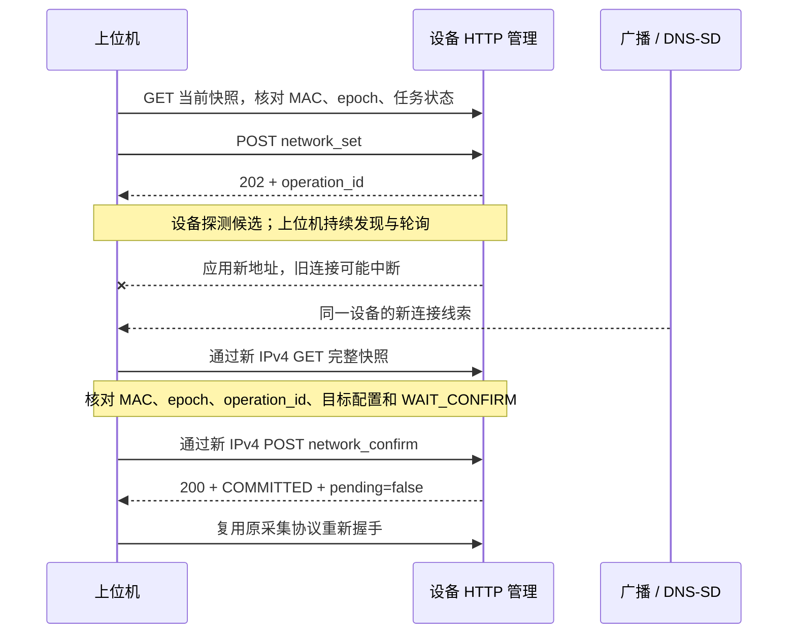

# 设备 IP 配置与发现：上位机开发指导

日期：2026-11-13。协议：`lidar-network`，版本 1。适用对象：在现有上位机中实现设备发现、IPv4 配置和改址后的重新连接。

本文依据当前工作区实际实现编写，区分设备已提供的接口与上位机需要开发的行为。设备源码和主机模拟测试已完成，Beta ARM64 开发包已生成；新网络功能尚未部署或完成真实网卡、多机 mDNS、旧上位机及断电验收。不能直接拿旧文档中的某个设备 IP 当作已部署的新接口。

配套文件：

- [独立 Agent 任务书](交给上位机Agent-IP功能开发任务.md)：可直接交给另一个 Agent。
- [OpenAPI](接口/lidar-network-v1.openapi.yaml)：HTTP 路径和请求结构。
- [报文与场景样例](接口/lidar-network-v1.examples.json)：均为构造数据，供界面和异常测试使用。
- [设备端实现说明](../network/README.md)：设备服务、存储、启动和实机边界。

## 1. 本轮要交付什么

在目标上位机的现有技术栈中增加以下能力，保留已有采集功能：

1. 选择电脑网卡，发现该链路内的多台雷达，按设备身份区分并显示实际地址。
2. 查询设备当前网络、最后确认配置和进行中的网络任务。
3. 设置 `auto`、`pool`、`static`，支持改址后的发现、连接验证和确认保存。
4. 展示冲突、地址范围耗尽、确认超时回滚、只读恢复地址和接口未部署等不同情况。
5. IP 改变后，复用原有采集协议重新握手，恢复正确的设备会话。
6. 提供可重复的客户端模拟测试、构建说明和实机联调记录模板。

第一版支持多设备发现和单设备配置。暂不做批量写 IP、完整调试租约、SN 写入、固件升级或自动更改电脑网络配置。设备 API 已经存在，不需要另写 CGI、SSH 后端或设备寻址守护进程。

## 2. 模式、表单与校验

| 用户界面名称 | `mode` | 请求字段 | 设备行为 |
| --- | --- | --- | --- |
| 自动获取 | `auto` | 只有 `mode` | 持续 DHCP；没有可用租约时使用 Link-Local |
| 指定范围自动选址 | `pool` | `start`、`end`、`netmask`、可选 `gateway` | 在范围内选一个可用地址并探测；跳过网关 |
| 固定 IP | `static` | `address`、`netmask`、可选 `gateway` | 探测通过后使用指定地址 |

界面切换模式时，构造对应模式的新请求对象。不要把隐藏表单中的 `address`、`start` 或旧值一起发到 `auto`，设备会拒绝额外字段。

客户端先完成以下校验，设备仍是最终裁决者：

- IPv4 使用四段十进制解析，内部转换为无符号 32 位数后再比较，不能按字符串排序；发送时规范为点分十进制。
- 掩码必须连续，对应 `/1`～`/30`，拒绝 `/0`、`/31`、`/32`。
- 拒绝 `0/8`、`127/8`、`169.254/16`、组播和保留地址。主机位不能全 0 或全 1。
- 地址池包含两端，要求 `start <= end`、同一子网，数量 `end - start + 1 <= 65534`；完整范围不能穿过上述禁用地址段。
- 网关可以省略、空字符串或 `0.0.0.0`，统一按“无网关”处理。非零网关必须是同一子网有效主机，不能等于固定设备地址；地址池包含网关时设备会跳过它，仅有一个候选且等于网关的池无效。
- 不使用“最后一段必须是 1～254”的判断。例如 `/23` 下的 `10.42.1.0` 是合法主机地址。
- 客户端不预先分配池内具体 IP，不计算 SN 对应 IP，也不把 PC 侧 ping 失败当作地址空闲。ARP 探测和选址由设备执行。

同一配置再次提交仍可能创建新任务，不要假设设备自动识别为无需执行。客户端可对规范化后完全相同的表单不发起写入。

自动模式不等于常驻“双地址”，也不等于“启动后一定是 DHCP”。实际来源以 `source` 为准。已有固定地址或地址池的设备，换成电脑直连后不会自动忽略用户配置，需主动切换到 `auto`。

这里的地址唯一性由同一二层链路内的冲突检测保障，不是跨路由器、跨 VLAN 的全局地址登记。不同隔离网络可以使用相同 IPv4；客户端仍需保留网卡作用域，并用 MAC 和设备身份关联设备。mDNS 负责服务发现与名称冲突处理，不负责分配或保证 IP 唯一。

## 3. 发现服务与设备身份

### 3.1 UDP 广播发现

在选定网卡上监听 UDP 5354。当前设备约每 5 秒向受限广播地址发送一次 UTF-8 JSON；没有可用地址时可能收不到广播。这个端口是设备发现端口，不是 HTTP 管理端口。

示例报文：

```json
{
  "schema_version": 1,
  "protocol": "lidar-network",
  "identity": "CS96000B0126020001",
  "identity_source": "sn",
  "sn": "CS96000B0126020001",
  "mac": "28:b5:e8:e2:60:19",
  "model": "CS96-beta",
  "address": "10.42.0.120",
  "source": "pool",
  "phase": "READY",
  "ready": true,
  "recovery": false,
  "generation": 7,
  "service": "http",
  "path": "/cgi-bin/lidar_network.cgi",
  "port": 80
}
```

接收时必须保存本机接收接口及源地址，校验协议名、版本、IPv4、MAC、端口和字段类型。接收缓冲区建议至少 4096 字节并检测截断；丢弃无法解析的包，不影响其他设备。

当前报文使用 `address`，没有验证工具中的 `ip`、`ip2`、`FREE/LOCKED`、8080 文本控制端口或租约 token。不能原样复制 `lidar_scan.ps1` 的字段假设。`port` 来自设备管理配置，源 UDP 端口不是管理端口。

广播只提供连接线索，不等于设备可访问或任务已完成。得到候选入口后用 HTTP GET 获取完整快照并核对身份。源地址与报文地址不一致时保留异常信息并重新核对，不能据此直接发送确认。

### 3.2 mDNS / DNS-SD

浏览 `_lidar._tcp.local.`。通过 PTR 找服务实例，通过 SRV 取主机和端口，通过 A 取 IPv4；TXT 当前包含：

| TXT 字段 | 内容 |
| --- | --- |
| `proto` | 字符串 `1`，不是 JSON 整数 |
| `identity` | 真实 SN 或 `mac-` 前缀的临时身份 |
| `sn` | 真实 SN；未提供时可为空 |
| `model` | 机型 |
| `path` | `/cgi-bin/lidar_network.cgi` |
| `modes` | `auto,static,pool`，用于展示当前协议能力 |

TXT 当前不包含 MAC、`epoch`、完整网络任务、实时占用人或会话锁状态。首次从 mDNS 找到的设备，需 HTTP 查询后补齐 MAC，再与广播发现结果合并。

默认名字形如 `lidar-<identity>.local`，重名后由 Avahi 处理，实际主机名可能变化。必须使用实际解析结果，不能按 SN 拼接一个固定 `.local` 名字，也不能假定系统 `ping xxx.local` 成功才可发现。mDNS 不通时继续使用广播或用户手动输入地址。

### 3.3 列表合并与去重

建议采用以下客户端数据模型：

```text
设备记录
  本机网卡稳定标识 + 规范化 MAC                 连接作用域内的主键
  identity、identity_source、sn、model          设备声明身份
  多个候选入口：IPv4、端口、路径、接收接口、发现来源
  最近广播时间、最近 HTTP 验证时间、完整快照
```

- IP 是连接位置，`operation_id` 是任务关联标识，都不能作为设备永久主键。
- MAC 统一为相同大小写和分隔形式。SN 重复而 MAC 不同，应保留两台并提示重复身份。
- 同一 MAC 从多个本机网卡出现时，关联为可能相同设备，但保留不同连接作用域，不能随意选择出口。
- SN 从未写入变为有效值时，结合 MAC 和接口更新身份，不直接新建另一台设备；若发生在任务期间，停止自动确认，重新核对。
- MAC 与其他身份信息矛盾、同一 MAC 出现无法解释的并发设备时，标记歧义并停止自动写操作。
- 可采用 15 秒未收到发现更新标记过期、30 秒标记疑似离线。这是建议的客户端策略，不能据此删除进行中的任务或把一次丢包视为改址失败。

## 4. 电脑网卡与可达性

上位机应允许用户选择网卡，显示网卡名称、稳定标识、接口索引、链路状态、本地 IPv4 和掩码。广播发现、mDNS 和 HTTP 连接必须带着这个接口上下文执行，防止被 Wi-Fi、VPN 或另一块有线网卡的路由带走。

采用目标技术栈支持的原生接口绑定或源地址绑定能力；多网卡下没有明确出口时，应提示选择网卡，而不是向所有候选设备试写。网卡重新插拔后索引可能变化，需重新枚举并恢复稳定标识关联。

提交前检查电脑是否有到新网段的可用路径。仅收到广播但无法 HTTP 连接时显示“已发现，当前网卡不可达”，同时展示电脑地址与设备地址。

直连的 `169.254.x.x` 地址需要电脑在同一链路具备合适的本地地址和路由。已有普通网段地址的电脑不能一律假定也有可用 Link-Local 地址。第一版提供诊断和手动配置指引，不自动清除 DHCP、替换默认网关或添加一个猜测的电脑 IP。

设备跨子网改址前，应先准备电脑到目标网段的连接条件。确需增加电脑辅助地址时，由用户通过明确操作完成，避免选入设备地址池、网关或其他已使用地址；不把电脑网卡管理混入设备设置 POST。

仅网页运行环境不能直接监听原始 UDP 或自行管理多网卡。如果目标已有网页外壳，应复用其原生宿主或既有本地辅助服务；不要把浏览器跨域 fetch 当作完整桌面网络发现实现。

## 5. HTTP 契约

### 5.1 地址与方法

| 方法 | 路径 | 用途 |
| --- | --- | --- |
| GET | `/cgi-bin/lidar_network.cgi` | 查询业务网络快照 |
| POST | `/cgi-bin/lidar_network.cgi` | 设置、确认或恢复自动模式 |
| GET | `/cgi-bin/lidar_network_status.cgi` | 系统只读诊断，直接查询网络服务 |

优先使用发现得到并验证过的 IPv4 和管理端口。缺少发现线索时允许手动地址，默认 HTTP 80，再通过 GET 进行能力和身份校验。新设备地址确认应连接具体 IPv4，不依赖可能仍缓存旧地址的主机名。

当前接口不接受 URL 查询参数，不能用 `?op=...` 或 `?t=时间戳`。POST 使用 `Content-Type: application/json` 和 UTF-8 紧凑 JSON，由 HTTP 库生成正确长度；CGI 上限为 2048 字节，正常客户端请求保持小于 1024 字节。不要使用自定义路径、命令或本地套接字参数。

建议 GET 单次总超时约 2 秒，POST 约 5 秒，避免长时间阻塞界面；均为客户端可调整的起始参数。一次 POST 不等待整个地址探测结束。禁用对 POST 的网络错误重试和自动重定向，防止在另一个地址重复执行写入。

现有响应已经带 `Cache-Control: no-store`，客户端同样不缓存状态查询。原生客户端不伪造浏览器 Origin；浏览器存在 Origin 时，设备检查与当前 HTTP Host 同源，未提供通配 CORS。复用现有认证和部署约束，不能通过关闭来源校验或 SSH 后备绕过接口。

### 5.2 三种设置请求

```json
{"op":"network_set","config":{"mode":"auto"}}
```

```json
{"op":"network_set","config":{"mode":"pool","start":"10.42.0.100","end":"10.42.0.150","netmask":"255.255.255.0","gateway":"10.42.0.1"}}
```

```json
{"op":"network_set","config":{"mode":"static","address":"10.42.0.120","netmask":"255.255.255.0","gateway":""}}
```

POST 必须精确包含 `op` 与 `config`。不要额外发送 `schema_version`、`legacy`、`force`、客户端任务号或其他隐藏字段；当前 HTTP CGI 会拒绝。未知字段不是静默忽略的扩展机制。

### 5.3 确认与恢复自动模式

确认只能在新设备地址的同一路径提交：

```json
{"op":"network_confirm","operation_id":"11111111111111111111111111111111"}
```

任务号必须使用设备返回的 32 位小写十六进制值。HTTP 客户端不能发送 `via_address`，该字段由 CGI 根据实际连接的本机目标 IPv4 填入。不要调用设备内部的 `network_apply`、UDS 或 DHCP 回调操作。

恢复自动模式：

```json
{"op":"network_reset"}
```

它等价于发起自动模式设置，仍需重连确认；不是取消任务、恢复出厂、清空文件或解除 FAULT 的入口。设备已有待处理任务时会拒绝新设置，没有公开的网络任务取消接口。

### 5.4 状态码与响应形状

| HTTP / `code` | 含义 | 上位机处理 |
| --- | --- | --- |
| 200 | 查询或确认成功 | 查询是否成功与配置是否提交分开判断 |
| 202 | 设置已受理 | 保存关联信息，轮询和重新发现，不能立即提示成功 |
| 400 | 请求形状、字段或格式错误 | 显示错误，修正请求；不重发原写请求 |
| 403 | 请求来源不符合要求 | 检查客户端接入方式，不关闭设备校验 |
| 404 / 405 / 501 | 路径、方法或能力未部署/不支持 | 标记能力不匹配，不切到旧脚本或 SSH |
| 408 | 当前 CGI 可能为读取请求体超时 | 与 GET 快照中的 `operation_code=408` 区分；后者为任务确认超时 |
| 409 | 任务、模式切换或确认状态冲突 | 查询当前快照；不排队、不自动覆盖别人的任务 |
| 413 / 415 | 请求体过大 / 类型不符合要求 | 修正客户端请求 |
| 422 | 网络参数无效 | 保留表单，提示修正 |
| 500 | 持久化、应用或确认保存失败 | 查询任务状态，不能误报已经保存 |
| 503 | 管理或网络服务不可用，或处于故障 | 区分“设备 HTTP 可达”与“管理服务可用”，允许诊断 |

HTTP 错误体不保证是完整网络快照：CGI 可能只返回 `{code,message}`；管理层也可能返回模式管理形状，其中的 `phase` 不是网络阶段。先解析通用错误，再在 `schema_version=1` 且网络字段完整时解析为网络快照。反向代理也可能返回非 JSON 错误页，不得据此清空设备真实配置。

网络业务 CGI 当前使用 503 表达桥接不可用或超时，不照搬旧模式指南的 502/504 细分假设。无响应、超时和异常响应一律不能触发自动重发设置。

## 6. 完整快照怎么使用

以下均是网络服务快照字段，不与模式切换快照混用：

| 字段 | 使用规则 |
| --- | --- |
| `schema_version` | 当前为整数 1；未知版本只读展示，不发送写请求 |
| `simulation` | true 时显著显示“模拟环境”，不能当作实机验收 |
| `identity`、`identity_source`、`sn`、`mac` | 核对设备；空 SN 不能伪装成正式序列号 |
| `interface` | 设备自己的网卡名，例如 eth0；不是电脑网卡索引 |
| `address/netmask/gateway` | 当前实际生效值；空地址表示当前没有可用地址 |
| `source` | `dhcp/linklocal/static/pool/recovery` 或空字符串，和用户配置模式分开显示 |
| `ready` | 当前有业务可用地址；不是确认持久化或收到点云的证据 |
| `recovery` | 管理恢复状态。可访问管理接口，不代表业务地址符合目标范围 |
| `configuration_valid` | false 时配置对象不能当作有效用户数据；显示故障并禁用配置写入 |
| `phase` | 地址生命周期；见下表 |
| `pending` | 设备有尚未完成的网络设置；不是“当前客户端拥有任务” |
| `transaction_phase` | 设置事务阶段；不能由 `phase=READY` 代替 |
| `operation_id` | 当前/最后任务标识，不是幂等键、独占锁或历史任务查询入口 |
| `operation_code` | 任务结果：处理中 202、确认成功 200，或失败码。不能代替本次 HTTP `code` |
| `confirmed_config` | 最后确认保存的模式及参数，不等于当前实际 IP |
| `desired_config` | 此刻设备尝试的配置；失败恢复时会变为旧配置 |
| `candidate_address` | 正在考虑的候选，不能据此认定已应用或可连接 |
| `confirm_remaining_ms` | WAIT_CONFIRM 期间剩余确认时间；其他阶段为 0，不代表这些阶段失败 |
| `epoch` | 网络服务本次进程实例标识，不是 SN，也不等于 Linux 整机启动编号 |
| `generation` | 部分状态变化计数；不是每个响应或事务变化都递增，不可用作唯一增量版本 |
| `attempt`、`conflict_mac`、`error` | 诊断信息；不能依赖文本匹配控制程序，也不把计数假定为准确扫描进度百分比 |
| `mdns_running` | 当前 mDNS 子进程存在，不等于电脑实际收到 mDNS |
| `management_port` | 当前配置的管理端口，和 UDP 5354、原采集端口分开 |
| `legacy` | 旧协议适配信息；新客户端不主动设置或依赖它完成新流程 |

| 网络 `phase` | 界面含义 |
| --- | --- |
| `WAIT_DHCP` | 等待自动地址，尚不代表失败 |
| `PROBING` | 正在探测候选，地址池可能继续换候选 |
| `READY` | 某个地址已生效，仍需检查事务是否确认 |
| `LINK_DOWN` | 设备链路未连接 |
| `BACKOFF` | 连续冲突后退避，不能显示进度卡死 |
| `NO_ADDRESS` | 当前没有可用地址，保留诊断 |
| `FAULT` | 配置或服务故障；查询可能仍为 HTTP 200 |

| `transaction_phase` | 上位机动作 |
| --- | --- |
| `IDLE` | 无本次进行中设置，不虚构历史任务 |
| `PROBING` | 继续查找和轮询，原连接仍可能可用 |
| `PREPARED` | 旧协议内部阶段，新客户端只观察，不调用 network_apply |
| `APPLY_DELAY` | 即将换址，继续监听发现；短暂断线正常 |
| `WAIT_CONFIRM` | 核对归属和新地址后确认 |
| `COMMITTED` | 配置已确认；仍要核对本次任务号、epoch、目标和当前健康状态 |
| `FAILED` | 本次目标失败；观察旧配置是否已恢复可用 |
| `ROLLED_BACK` | 网络服务重启时撤销未确认任务；不能归类为本次成功 |

未知阶段保留原始值、只读展示并停止自动确认。相同 `generation` 的新快照仍可能已经从 WAIT_CONFIRM 变为 COMMITTED，必须解析更新。广播当前不包含 `epoch` 和完整事务，不能用广播完成任务归属判断。

## 7. 单次设置的完整状态机

### 7.1 客户端保存的任务上下文

在 POST 前创建本地任务记录，至少包含：

```text
本地任务编号（不发送给设备）
设备 MAC、身份快照、本机网卡稳定标识
提交前 epoch、operation_id、入口地址、最后确认配置
requested_config（规范化后保持不变）
已取得的设备 operation_id，未取得时留空
是否已经发送设置、是否已经发送确认
客户端请求序号、接收时间、确认倒计时依据
```

请求地址和设备当前状态可以变化，`requested_config` 不能被回滚后的 `desired_config` 覆盖。每条异步响应带本地选择上下文和请求序号，切换设备或网卡后，旧响应不能更新当前表单或触发确认。

### 7.2 正常流程



具体要求：

1. GET 核对能力与设备身份。`configuration_valid=false`、恢复状态、未知协议或已有他人任务时，先进入相应只读状态；明确区分可修复的业务地址恢复状态与配置文件故障。前者可在用户操作下重新设置，后者设备会拒绝。
2. 检查电脑到目标网段的条件，保存提交前基线，禁用重复提交及同设备模式切换。
3. 发送一次设置。收到 202 后保存返回的 `operation_id` 和 `epoch`，显示“已受理，正在探测”，不能显示“设置成功”。
4. 持续发现，并按约 500～1000ms 间隔发起有超时的 GET；同一入口不叠加无限并发请求，失败后适度退避，避免多个客户端形成请求风暴。
5. 旧地址失联时并行检查旧入口、已知且可达的新候选和新发现入口。每次 HTTP 连接显式绑定所选网卡/源地址，并重新核对 MAC。不要沿用旧 TCP 连接或只信 `.local` 缓存。
6. 只有在完整快照满足以下条件时，自动发送一次确认：设备 MAC/连接作用域匹配、epoch 未变化、operation_id 匹配已受理记录、pending=true、transaction_phase=WAIT_CONFIRM、configuration_valid=true、recovery=false、实际地址符合 requested_config、desired_config 与请求一致。
7. `static` 必须是指定地址且 source=static；`pool` 必须位于指定范围、不是网关且 source=pool，两者均需核对实际掩码与网关。`auto` 接受实际 DHCP 或合法 Link-Local，不预测固定值。设置新配置的普通路径不将 `source=recovery` 当作目标成功。
8. 根据 `confirm_remaining_ms` 和本机单调时钟显示倒计时，计入网络耗时余量，尽快确认。默认 60 秒从设备进入 WAIT_CONFIRM 开始，不从提交 POST 开始。不要硬编码为恰好 60 秒或把 PROBING 的剩余时间 0 当成过期。
9. 确认响应或后续 GET 同时满足下列条件，才把本次任务标为成功：同 MAC 和连接作用域、同 epoch、同 operation_id、pending=false、transaction_phase=COMMITTED、operation_code=200、confirmed_config 规范化后等于 requested_config，且 configuration_valid=true、recovery=false、ready=true 并有符合目标的实际地址。
10. 随后恢复采集连接；“配置已保存”和“已重新收到有效数据”分别显示。

端口或当前 IP 变化、设备身份歧义、任务号变化、epoch 变化、模拟/实机环境变化，都必须重新校验。任务完成后的历史结果与设备后续健康状态分开保存：后来一次 DHCP 地址变化或地址冲突，不应把此前已确认的设置历史改写成另一任务。

### 7.3 失败、回滚和响应丢失

| 情况 | 必须采取的动作 |
| --- | --- |
| 新目标固定地址冲突、池耗尽 | 本次目标失败；恢复后的旧地址可能 ready=true，但不能显示新目标成功 |
| `operation_code=408` 或确认失败后恢复 | 显示“新配置未确认，正在/已经恢复旧配置”，继续定位设备 |
| 原地址也不可用，出现 recovery=true | 显示“管理恢复地址”，保留原固定/池配置，允许用户诊断；不报目标成功 |
| POST network_set 超时，未拿到任务号 | 标记结果未知，只查询和发现，不重发、不自动确认碰巧相同的目标 |
| 确认 POST 响应丢失 | 用已知任务号和 epoch 查询；匹配 COMMITTED 才成功。仍 WAIT_CONFIRM 时可明确提示用户重新确认，不能无条件重发 |
| `operation_id` 与自己的记录不同 | 观察当前外部任务，停止自动写入；不确认或覆盖别人的任务 |
| `epoch` 改变 | 网络服务已换实例；停止原自动确认，按重启/恢复重新评估，不把保留的任务号当作进程未变 |
| 页面刷新或客户端重启 | 仅恢复已保存且取得受理任务号的本地上下文，并重新核对；无上下文不自动认领当前任务 |
| 查询失败但设备仍有广播 | 显示“发现在线、管理连接不可用”，保留设备和任务，继续有限度探测 |

当前设备没有客户端幂等键、任务历史查询、取消任务或锁持有人字段。因此，设置响应丢失时，即使看到一个“新任务 + 相同配置”，也不能证明它来自自己。默认只读等待回滚或由用户明确处理，不实现基于猜测的自动接管确认。

界面的“停止等待/关闭窗口”只影响客户端，不等于取消设备任务；不得提示“已取消设备设置”。配置选择可能持续很久，确认窗口又是在应用后才开始，不能承诺从提交起 60 秒一定回滚。

## 8. 界面与实现分层

设备列表建议显示：设备身份、SN 状态、MAC、机型、本机网卡、当前地址、来源、发现/HTTP 可达性、恢复/故障/模拟标识。不要显示未实现的 FREE/LOCKED 或独占调试占用人。

网络面板分开展示“实际网络”“最后确认配置”“待提交表单”和“本次任务”。固定或池配置仍保留、实际却使用恢复地址时，必须能同时看见两者。

复用现有技术栈，建议拆成可替换和可测试的职责：

| 模块 | 职责 |
| --- | --- |
| 网卡与连接上下文 | 枚举、接口绑定、可达性诊断，保留稳定接口标识 |
| 发现模块 | UDP、DNS-SD、手动入口、过期处理和去重 |
| 网络 API 客户端 | HTTP 方法、超时、通用错误与完整快照解析，控制 POST 重试 |
| 配置模型 | IPv4 数值校验、模式字段白名单、配置规范化及比较 |
| 设置任务控制器 | 任务上下文、重新发现、归属核对、单次确认、恢复和结果未知状态 |
| 界面状态 | 展示与操作开关；不在界面事件中散写网络请求 |
| 采集会话适配 | 地址变化后清理旧会话、重新握手并验证实际数据 |

推荐先完成模拟状态机和 API 层，再接实际发现与界面。需要新增 mDNS 依赖时，按目标仓库已有构建与依赖管理方式集成，不要求用户安装另一套全局运行环境。

## 9. 与模式切换和原有采集衔接

网络配置和采集模式是不同维度，`auto/static/pool` 不能映射成 `work_mode`。模式 HTTP 路径、其快照与网络快照分别建模。

同设备有网络 pending 时，客户端禁用模式切换；模式切换或硬件恢复进行时禁用新的网络设置。设备也会返回 409，客户端不能自动排队到操作结束后执行旧意图。

IP 变化后作废旧数据连接、旧命令目的地址和旧重连计划，必要时清空接收帧缓存。复用既有采集握手与心跳，按原协议提供电脑接收地址和端口；确认数据来自选定设备后恢复显示。

新客户端使用 HTTP 完成网络配置，不把旧 UDP 固定 IP 命令当作失败后备。旧 UDP 入口由设备内部适配，仍需实际旧上位机联调。保留既有 55000 发现和数据协议，不把它们改成 UDP 5354 JSON，也不因为网络接口存在就迁移所有采集协议。

SN 通过查询获得。旧广播可能使用 `MAC-` 前缀兼容身份，不能把它当作出厂 SN，也不能使用旧文档中编译在程序内的 SN 常量作为设备真值。

## 10. 测试和验收

客户端测试应使用可控的 HTTP/UDP/DNS-SD 替身，覆盖状态变化和真实异步顺序；`接口/lidar-network-v1.examples.json` 只提供构造报文，不代替时序测试。

样例文件中的 `requests` 是可发送请求体，`responses` 的每项给出 HTTP 状态和响应体；`scenarios` 通过 `response_keys` 按顺序引用这些响应，并描述本地任务上下文与预期行为。`client_context`、`expected` 等都是测试说明，不是设备协议字段，不能随 HTTP 请求发送。所有值均为虚构，完整网络快照标记 simulation=true，不是实机采样。

| 场景 | 验收结果 |
| --- | --- |
| 三种模式及非法字段 | 请求字段精确；auto 不带隐藏地址；错误范围、掩码和网关在提交前提示 |
| `/23` 中合法末段 .0/.255 | 不按旧 `/24` 规则误拒；网络与广播地址仍正确拒绝 |
| 多设备、重复 SN、无 SN | 正确区分设备；临时身份和重复情况明确；不写死身份 |
| 多网卡和 VPN | 保留发现接口，HTTP 使用正确出口；不能误配置另一台设备 |
| mDNS 不通 / 广播不通 | 另一发现通道或手动入口仍可使用，错误通道可诊断 |
| 旧验证工具报文与恶意/截断 JSON | 不能误认协议版本、字段或控制端口；不影响其他设备 |
| 202 + phase=READY + WAIT_CONFIRM | 仍显示待确认，不提前显示保存成功 |
| 池内首候选冲突后换址 | 使用设备实际返回的地址，始终核对范围，不由客户端偏移猜地址 |
| 池耗尽后旧地址恢复 | 显示目标失败和已恢复值，不能被 ready=true 误导 |
| 新地址 HTTP 可达但 MAC 不同 | 不确认、不写入，显示身份不匹配 |
| POST 请求已经执行但响应丢失 | 只读查询，写请求发送次数仍为 1 |
| 确认响应丢失 | 依据同任务的提交状态恢复结果，不重复设置 |
| 他人相同配置的任务出现 | 不凭配置相同认领任务，不自动确认 |
| 同 generation，pending 从 true 变 false | UI 仍更新为提交结果，不丢弃合法快照 |
| epoch 变化而 operation_id 保留 | 停止原自动确认，识别恢复/重启情况 |
| 确认超时、拔网线、回滚后旧地址也冲突 | 显示失败/恢复；能重新发现或给出明确不可达原因 |
| 配置损坏或存储不可用 | FAULT 与 HTTP 可达分开；不将占位配置显示成真实配置，不允许写入 |
| 409、503、404、非 JSON 错误页 | 错误类别正确；不使用 SSH、旧 CGI 或重试 POST 兜底 |
| 切换设备时迟到响应 | 不能污染当前界面或确认其他设备 |
| 停止等待、关闭窗口 | 不误报设备任务已取消；能够保留并重新核对已知任务 |
| 网络设置与模式切换并发 | 单客户端禁用冲突操作，后端拒绝时不自动排队 |
| 网络变更后恢复采集 | 目的地址更新，重新握手，收到有效数据后才显示收流恢复 |
| simulation=true | 明显标识，不计入实机验收 |

设备端已有可参考的隔离测试：`scripts/test_lidar_network.py`、`scripts/test_lidar_mgrd.py`。网络服务 `--simulation` 不会发真实广播或运行 Avahi，并将状态机时钟加速 20 倍；不能拿它验证真实 mDNS、电脑路由或实际 60 秒倒计时。客户端普通时序测试应使用自己的可控时钟与协议替身。

实机联调前由设备侧确认新 CGI、网络服务、Avahi 和可信镜像已部署，提供实际设备 MAC/SN、地址、端口和专用网卡。第一阶段先查状态和身份，再测试单台的同网段固定地址、范围、自动模式；之后再做跨子网、多机冲突、断链、重启与断电。未提供设备部署范围前，开发 Agent 不自行操作历史文档中的设备。

### 10.1 设备镜像的 Avahi 前置条件

当前方案需要在 Buildroot 中开启 Avahi 的 mDNS/DNS-SD daemon：

```ini
BR2_PACKAGE_AVAHI=y
BR2_PACKAGE_AVAHI_DAEMON=y
# BR2_PACKAGE_AVAHI_AUTOIPD is not set
```

本机 Buildroot 包定义中的 AUTOIPD 默认开启，选择 Avahi 后需明确取消；地址配置统一交给 lidar_netd。daemon 会选择 libdaemon 和 expat 依赖。本服务不要求专门开启 D-Bus，运行时使用 enable-dbus=no；也不要求开启 Bonjour 兼容库或默认 SSH/SFTP 服务。其他组件已依赖 D-Bus 时保持其配置。

设备侧将[Buildroot 配置片段](../deploy/network/buildroot.fragment)合入实际有效配置，按现有构建流程重新解析依赖、构建并安装到镜像；不能只复制一个缺少运行依赖的 avahi-daemon。当前工程的镜像集成会接管默认 Avahi 启动脚本，由 lidar_netd 启动唯一实例，不能另加一份独立启动命令。

缺少 Avahi 时 UDP 广播通道仍可工作，但 mDNS 验收不成立，当前完整镜像集成还会检查 avahi-daemon 是否存在。上位机 Agent 应报告镜像依赖，复用广播或手动入口继续客户端开发，不修改设备系统来掩盖部署缺口。本次未修改外部 Buildroot 的有效配置。

## 11. 交付要求

交付可编译的上位机改动、必要依赖及版本说明、接口封装和任务状态机、自动化测试、运行说明与实际验证记录。测试记录分成“客户端模拟通过”“与设备模拟服务联调”“实机通过”“受设备部署或环境限制未测”，不要把前一类结果当成后一类。

开发完成报告至少说明：修改了哪些模块、请求与发现如何绑定网卡、POST 超时如何处理、怎样防止误认任务、怎样重新确认地址和恢复采集，以及哪些实机项目尚未完成。设备侧接口与文档不一致时记录最小复现，先按真实实现核对，不在上位机中静默补造新接口。

实机联调记录采用以下模板，每个场景单独填写；没有测试时填“未测”并注明依赖：

| 记录项 | 填写内容 |
| --- | --- |
| 日期与版本 | 上位机提交号、设备镜像/应用版本、接口版本 |
| 连接条件 | 专用设备 MAC/SN、电脑网卡与本地 IPv4、设备原 IP、管理端口 |
| 本次设置 | 原 confirmed_config、requested_config、任务号、提交前后 epoch |
| 发现与换址 | 使用的发现通道、实际新 IP、是否通过选定接口重连 |
| 确认与结果 | 确认发送次数、最终事务阶段/结果码、实际和确认配置 |
| 采集恢复 | 重握手结果、是否收到该设备有效数据 |
| 证据与未测项 | 脱敏日志位置、实际结果、失败复现、尚未具备的测试条件 |
