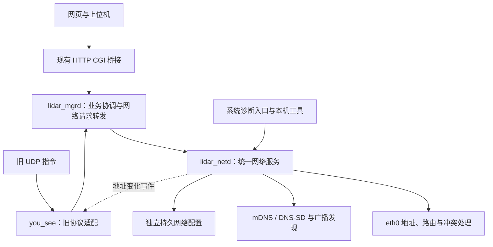

# 设备网络管理：Link-Local 与 mDNS 接入方案

日期：2026-11-13。状态：已按本设计实现源码并补充 `pool` 范围选址；主机测试和 ARM64 编译已通过，尚待真实设备与断电验收。当前实现及接口以 [network/README.md](../network/README.md) 和 [网络接口定义](接口/lidar-network-v1.openapi.yaml) 为准。

实施时的调整：用户模式扩展为 `auto`、`static`、`pool`；mDNS 使用关闭 D-Bus 的 Avahi 系统组件，避免自行维护 DNS 编解码与冲突协议。持久事务收敛为单个原子网络状态文件，避免多个文件提交不一致。下文保留分层设计与取舍依据。

本方案以同事的验证资料确认需求和使用场景，重新设计产品实现。验证程序继续留在 `doc/locklink_mDNS方案/lidar_ll/`，不作为生产可执行程序直接安装，也不按单文件结构搬进采集应用。

## 1. 推荐结论与功能边界

新增独立系统服务 `lidar_netd`，统一管理设备本机 IPv4 地址、ARP 地址冲突检测、DHCP 生命周期、mDNS/DNS-SD 和广播发现。源码建议放在本仓库新的 `network/` 目录，运行程序及监督入口随基础系统交付。

现有 `lidar_mgrd` 负责业务管理入口和与采集控制的协调；网页、命令行和旧 UDP 改 IP 指令经统一业务仲裁后调用网络服务。`you_see` 保留点云发送、旧协议适配和握手，不再直接修改网卡、路由及系统网络配置。

这里的目标应表述为：**在同一二层链路内探测和处理 IPv4 冲突，使设备获得可用地址，并能按设备身份重新发现。** 不能承诺跨网络的 IPv4 全局唯一，也不能保证网络中任意其他设备永远不会强占地址。Link-Local 的通信范围限于本链路，见 [RFC 3927](https://www.rfc-editor.org/rfc/rfc3927.html)。

mDNS 负责名称解析，DNS-SD 负责发现服务；它们不分配 IP，也不替代 ARP 冲突处理。设备稳定身份与当前 IP 分开管理。

## 2. 实施前核对的基线

| 位置 | 当前行为 | 接入影响 |
| --- | --- | --- |
| `doc/locklink_mDNS方案/lidar_ll/agent/lidar_agent.c` | 集成地址、发现、租约锁及 SETIP 的验证程序 | 作为行为参考，重新拆分实现 |
| `ys_business/ys_business_network.c:set_ip_info()` | 直接设置地址、掩码和网关，之后回复旧协议 ACK | 必须改成调用统一服务，避免地址先变导致回包失败 |
| `core/ys_file.c:update_interface_network()` | 重写 `/etc/network/interfaces`，经旧函数尝试临时挂载第三分区保存 | 与新存储管理职责冲突；且复制失败未完整传回，不能代表可靠持久化 |
| `ys_business/main.c`、`core/ys_core_network.c:check_route()` | 启动采集时若无默认路由，推导本机网段的 `.1` 作为网关 | 网络服务接管后移除这项写操作，Link-Local 不配置默认网关 |
| `ys_business/ys_business_network.c:proto_build_borad()` | 广播 SN 仍按型号写死 | 新旧发现统一读取真实身份，不能用这个常量派生地址 |
| `manager/lidar_mgrd.c` | 当前请求只支持 `status`、`switch` | 可扩展业务转发与协调，不将地址状态机塞进模式切换状态机 |
| `deploy/runit/` | 已有存储、Web、可信应用启动和单一监督树 | 网络服务接入现有监督体系，独立于采集与业务版本运行 |
| 相邻 Web 仓库 `you_see_cgi/src/lidar_management/` | 已有 CGI → 本地 UDS 管理桥接 | 沿用桥接方式扩展；本次不要求换一套 HTTP 服务 |

本机 Buildroot 保存配置已启用 `CONFIG_UDHCPC=y`、`CONFIG_ARPING=y`，`CONFIG_ZCIP` 未启用，Avahi 未启用。以上是保存配置，不代表同事最终构建的镜像或当前板端实际能力；镜像集成时核对有效配置和 applet。

## 3. 职责与部署位置



系统诊断入口直接访问 `lidar_netd` 的只读状态及受控恢复能力，不依赖业务包启动成功。业务网页正常使用 `lidar_mgrd`；不在网络服务里复制模式切换、升级或点云控制逻辑。

| 内容 | 建议归属 | 原因 |
| --- | --- | --- |
| `lidar_netd`、所需网络组件、固定启动与诊断工具 | 基础系统镜像 | 应用升级、采集崩溃或模式切换时仍能发现、连接设备 |
| 网络设置页面、业务 CGI、`lidar_mgrd` 转发逻辑 | 第三分区签名应用包 | 与业务接口配套更新 |
| 网络配置、最后确认配置与未完成事务 | 第三分区独立数据目录 | 应用升级保留；由网络服务独占写入 |
| 设备 SN | 现有第四分区 | 网络功能只读取，不承担 SN 烧写 |
| DHCP 租约运行信息、服务套接字和临时状态 | `/run/lidar-network/` | 与业务管理运行目录分开，避免互相清理 |

这一边界与现有[系统镜像与应用独立更新交付边界](系统镜像与应用独立更新交付边界-20261106.md)一致。代价是网络服务自身更新需要系统发布；第一版应保持接口小而稳定。

建议新增文件布局如下，实施时按功能量合并，不追求机械拆文件：

```text
network/
  CMakeLists.txt
  lidar_netd.c                  服务入口、非阻塞事件循环与请求处理
  network_config.c/.h           配置校验、事务、确认与恢复
  network_address.c/.h          地址策略、冲突处理与 DHCP 协调
  network_discovery.c/.h        mDNS/DNS-SD、广播及地址变更同步
  network_client.c/.h           供管理服务、采集适配层和 CGI 使用
  device_identity.c/.h          最小只读身份读取，可由其他模块复用
deploy/runit/rootfs/
  usr/share/lidar/runit/lidar_netd/...
  usr/libexec/lidar/...          服务准备、诊断、DHCP 事件适配
```

协议组件可以独立编译和验证，不依赖采集线程、FPGA 初始化或整套 `liblidar.so`。

## 4. 地址策略：采用标准行为，维护双地址作为可选能力

提供三个用户模式：

| 模式 | 行为 |
| --- | --- |
| `auto`，出厂默认 | 持续运行 DHCP 客户端；在没有可用租约时启用 Link-Local；后续获得租约再受控切换 |
| `static` | 完整设置 IPv4、掩码和可选网关，探测通过后应用；冲突时拒绝并保留旧配置 |
| `pool` | 上位机提供同一子网内的起止地址、掩码和可选网关；仅在范围内探测选址，跳过网关，耗尽时报告失败 |

手动设置支持完整地址和掩码，不沿用验证程序“只改第四段、固定 `/24`”的限制。校验掩码连续性、主机地址、网关可达条件及特殊地址，不能简单规定所有子网都禁止末段 `.0`、`.255`。

静态地址在启动时已被占用，或运行时持续冲突，则停止使用冲突地址，报告故障，并可进入明确标识的 Link-Local 恢复状态；不能悄悄改一个其他静态 IP，也不能覆盖用户保存的静态配置。

同事的“DHCP/静态地址 + 常驻 Link-Local”可作为显式维护选项，默认关闭。标准并不推荐同接口长期同时配置两类地址；获得可用可路由地址后，标准要求停止宣告 Link-Local 可达性。若产品选择保留并对外宣告维护地址，应明确属于产品扩展，并验证路由、源地址选择及上位机网卡绑定。依据见 [RFC 3927 第 1.9 节](https://www.rfc-editor.org/rfc/rfc3927.html#section-1.9)。

普通地址优先承载新连接，Link-Local 不设置默认网关。主机只有普通网段地址时，看到广播也不代表能直接连接 Link-Local，恢复工具应说明所需本地网卡配置。

## 5. 地址冲突处理与组件选型

不以 `crc16(SN)` 的结果证明唯一，也不把该结果承诺为永不变化的标签地址。优先以稳定 MAC 等输入初始化伪随机候选选择，必要时尝试上次可用地址；候选始终经探测确认，冲突后带随机退避重选。SN 用于身份与命名，修改或补写 SN 不应无理由重置当前网络配置。

实现应覆盖探测、宣告、持续监听、防御、退让、限速重试和链路重新接入。探测不仅检查对方声称已占用候选地址，也检查其他主机正同时探测同一候选地址；ARP 接收明确限制接口并校验报文格式，排除本机帧。按 [RFC 5227](https://www.rfc-editor.org/rfc/rfc5227.html) 实现，默认采用其探测时序和随机间隔，不因地址可计算就缩短为固定 `3 × 200ms`。

自动 Link-Local 冲突后重新选址；静态地址冲突后报告并恢复；DHCP 地址冲突需要通知 DHCP 配置流程并重新申请，不能自行偏移 DHCP 分配的地址。

选型建议：

- DHCP 复用系统 `udhcpc`，受网络服务管理；保留续租、失租与重新获取，不使用验证程序拿到地址就退出的 `-q` 路径。固定事件适配程序把结果交给网络服务，默认脚本不再绕过它设置网卡。
- Link-Local 优先评估启用 BusyBox `zcip`，作为受管理的地址冲突处理后端；核对实际版本行为、回调和退出恢复后决定采用。若不满足统一配置及静态地址探测要求，再实现独立、可测试的 ACD 模块，不能只抽出验证程序的 `arp_probe()` 就算完成。`zcip` 是可选 applet，需显式加入镜像，见 [BusyBox 官方说明](https://busybox.net/downloads/BusyBox.html)。
- mDNS 优先选择能覆盖名称探测、冲突处理、缓存更新及接口变化的小型标准实现；不因“单文件”就认定满足要求。对库的协议能力、许可、依赖和实测体积评审后再冻结，不照搬验证程序的 DNS 编解码。

`lidar_netd` 是配置写入的唯一协调者，受管理后端只通过指定回调申请配置变更；关闭同一接口旧 ifup DHCP 路径、旧 agent 和其他自动配网入口。第一版可以使用普通优先级的单线程事件循环，但所有探测、子进程与网络请求均有非阻塞状态或明确超时，不能长时间挡住续租、冲突监听及恢复定时器。

## 6. 身份与发现

网络服务启动时通过独立只读路径读取真实 SN，并校验长度、格式及空白分区；缺失时以完整稳定 MAC 构造临时身份，状态中明确 `identity_source=mac`，不伪造正式 SN。当前驱动 `SN_get()` 用 `O_RDWR` 打开分区，正式共享读取接口应改成只读并补全校验，不为联网而初始化采集驱动。

新旧广播、mDNS、管理查询使用同一身份来源。SN 重复时保留两台设备并报告身份异常，发现表还需结合 MAC 和接收接口区分，不能按 SN 直接把其中一台覆盖。

可继续使用 `lidar-<sn>.local` 和 `_lidar._tcp.local` 作为命名基础，但要实现名称合法化、长度限制、同名探测和冲突改名。缺失 SN 时使用 MAC 派生命名。服务记录公布的是实际可访问的产品协议、端口及路径；验证程序 TCP 8080 是文本命令服务，不能直接宣告成产品 HTTP 服务。

首版保留现有业务 UDP 广播和握手。新增 mDNS/DNS-SD，必要时保留独立 UDP 广播发现通道，但明确协议版本、地址列表、身份、接口作用域及服务能力；不把旧 55000 广播包格式替换成 5354 JSON。PC 按接口处理组播与广播并选择可达地址，广播也可能被网络策略或防火墙限制，不能承诺必达。

地址变更后同步更新发现记录，使用 cache-flush 刷新唯一记录、按需撤销共享记录或退出服务；不能把“所有地址变化都必须先给 A 记录发 goodbye”当作标准要求。实现依据见 [RFC 6762 第 8、9、10 节](https://www.rfc-editor.org/rfc/rfc6762.html)。服务发现记录依据见 [RFC 6763](https://www.rfc-editor.org/rfc/rfc6763.html)。

## 7. 改 IP 的统一接口与恢复流程

本地使用独立 UDS，例如 `/run/lidar-network/control.sock`，沿用项目的 JSON 请求和本地凭据校验方式。建议最小操作为 `network_get`、`network_set`、`network_confirm`、`network_reset`，协议带版本。查询同时返回用户配置、实际地址、当前来源、冲突信息、事务阶段和持久化状态。业务写请求统一经过 `lidar_mgrd`，包括旧 UDP 的转发，避免绕过模式切换仲裁；网络服务自行处理链路、续租和冲突事件，系统恢复入口单独定义可用条件。

网络配置与事务建议保存为：

```text
/mnt/mtdblock2/lidar/config/network.json    确认配置、候选配置和事务的单个原子记录
/run/lidar-network/control.sock
```

网络设置不能写到保存上位机收流目标的 `ys_conf.ini:[network].center_ip`，这两个地址用途不同。

改址流程：

1. 校验请求，串行接纳一个修改事务；业务管理入口协调模式切换等操作，旧 UDP 入口也受相同仲裁约束。
2. 探测候选地址，已占用时返回冲突及对端 MAC，保持现网配置。
3. 将候选配置、最后确认配置和待确认事务保存到同一原子记录，落盘失败则拒绝受理；采用临时文件、文件 fsync、rename、父目录 fsync。
4. 返回“已受理”和操作编号，在预定短延迟后应用；响应不表示最终持久生效。应用前若链路或配置已变化，重新验证候选。
5. 更新发现信息，客户端按身份重新发现，经新地址发送确认。新协议可先建议 60 秒确认窗口，最终参数经实际工具链验证确定。
6. 确认成功后提交；超时、应用失败或带未完成事务重启时恢复最后确认配置并重新探测。旧地址也可能被占用，恢复失败转入明确的恢复状态，不能强占。

事务状态及当前生效配置均由网络服务持有。网络服务重启要核对内核实际地址和受管 DHCP 状态，不能先清空网卡全部地址再从头配置。持久分区不可用时可提供明确标识的临时自动联网与诊断，但拒绝声称已保存设置。

旧 UDP 没有事务确认字段，需要兼容适配：保持现有数据格式，候选探测及待应用状态准备成功后先回 ACK，再切换；将规定窗口内通过新本机地址完成的有效重新握手作为兼容确认。需要识别请求到达的本机地址，不能把收到广播或任意心跳当成确认。确认超时回滚；这项语义变化须完成上位机联调后发布。

网络变更事件通过采集控制通道处理：清除旧握手与连接目标、重新广播和握手，安全重建必要的 socket。网络服务不直接操作点云线程中的 socket，也不为改 IP 重置 FPGA。第一版接受改址导致短暂中断收流。

## 8. 开机、监督与旧配置迁移

现有 `runsvdir` 由 BusyBox init 在 rcS 返回后启动。因此增加一个编号靠前的 S 脚本，并不意味着对应 runit 服务已经先运行；多个服务目录也没有天然启动顺序。

建议 `S35lidar_storage` 挂载后准备网络配置与服务目录，现有启动准备阶段同时登记 `lidar_netd`；rcS 返回后由同一 `runsvdir` 监督网络和管理服务。`lidar_mgrd` 启动采集前通过有时限的状态检查等待网络就绪，不能在 rcS 中等待尚未启动的监督树。无网线时服务仍可查询，报告 `LINK_DOWN`，采用明确的离线采集策略而非无限等待。

退出和关机顺序相反：先停采集与业务控制，再停止网络写入和 DHCP 后端，最后卸载持久分区。现有 `lidar-service` 仅认识 `lidar_mgrd`，需扩展或增加独立网络控制脚本，不能只复制一个服务目录而不处理停止、看护和存储卸载检查。SSH、Web 和 PTP 的启动入口一并核对，禁止隐藏在采集启动脚本中。

已有设备首次迁移时，读取并校验本机当前静态配置；无新版配置才导入，不把所有存量设备直接切成自动模式。后续不再由 `update_interface_network()` 挂载或卸载第三分区，不反复重写 `/etc/network/interfaces`。其他网卡及回环接口维持其明确的系统配置归属。

## 9. 同事实现中保留与重做的内容

| 内容 | 处理建议 |
| --- | --- |
| 分离地址、发现、使用权的思路；先探测再改址；广播兜底；按设备身份发现 | 保留作为需求和行为参考 |
| 单文件全局变量、文本 TCP 8080、固定改第四段、写 `/etc/lidar_ip.conf` | 按项目接口、配置和生命周期重新实现 |
| 仅检查 `spa == candidate` 的 `arp_probe()` | 补齐同时探测场景和标准时序，接口隔离、收包校验及失败处理 |
| 运行中冲突只反复 defend | 改成有时间约束的防御、退让和按地址来源恢复 |
| `udhcpc -q` 获取一次就退出 | 改成完整租约生命周期，统一处理地址与路由 |
| 未实现 mDNS 名称探测和重名处理 | 换成覆盖必要协议行为的实现并验收 |
| SETIP 先改地址，保存失败只打印日志 | 改为可查询、可确认、可回滚的持久事务 |
| SN 派生固定地址及固定偏移回退 | 改成标准候选选择、随机退避与真实身份分离 |
| 验证程序的 LOCK/RENEW/UNLOCK | 本期不作为全设备独占承诺；需要时另行覆盖所有修改入口及采集授权 |

独占调试与地址唯一是两个问题。只保护新 SETIP 入口的锁无法阻止旧 UDP、网页或其他控制入口修改设备。第一期先完成网络事务互斥；是否扩展为完整调试租约，另定统一授权与收流策略。

## 10. 实施顺序与验收

建议拆成四步，每一步都有独立可验证的结果：

1. **收敛所有网络写入口。** 新增服务、配置和本地客户端，接入旧 IP 指令，撤掉采集启动补网关及旧 Flash 保存路径；先完成规范静态配置和确认回滚。
2. **完成自动地址与恢复。** 接入 DHCP 生命周期和标准 Link-Local/ACD，处理断链重连、租约变化、同时上电与持续冲突。
3. **统一身份与发现。** 替换硬编码 SN，接入 mDNS/DNS-SD 和广播，联调网页、上位机多网卡与改址后重连。
4. **完成镜像交付。** 扩展 overlay、系统组件清单、监督脚本及生成工具；测试首次导入、冷启动、服务崩溃恢复及 JFFS2 断电恢复。

测试重点是行为与恢复结果：

- 不同设备同时上电；同 SN 不同 MAC；候选碰撞；两台同时 Probe；运行中强占地址后能收敛，不持续互相争用。
- 静态地址占用时拒绝且不误报保存成功；跨子网改址；无网关配置；确认超时、服务重启和断电后恢复最后确认状态。
- DHCP 正常、超时、续租、失租、地址变化及服务器恢复；Link-Local 全生命周期不偷偷添加默认网关。
- 组播不可用、广播受限、多网卡、mDNS 同名、地址缓存刷新，以及旧上位机广播和握手兼容。
- SN 未写入、无效和重复时仍可区分与诊断；真实身份在新旧接口一致。
- 停止采集、模式切换、业务包不可用时，基础网络与诊断仍可用；网络服务异常不破坏持久配置。

协议与故障测试先用主机隔离网络环境完成，再在专用开发板验证有效 BusyBox 配置、路由、接口和持久化，最后做多机共享交换机场景。本文依据本地源码、同事文档和标准进行设计，没有运行同事程序、连接设备、修改网卡或烧写 Flash。
